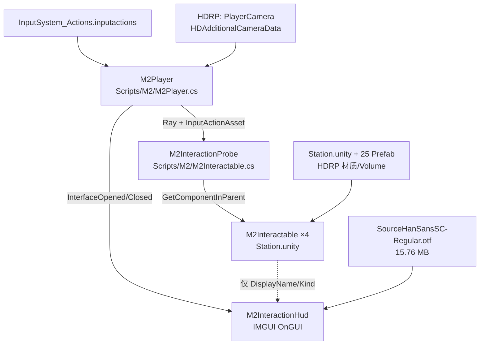
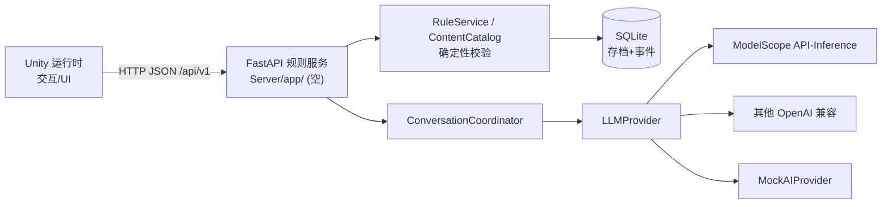

# DSH Gameplay 模块清单与可迁移性 · EchoLostAndFound

**审计人**：DSH　**日期**：2026-11-23　**性质**：只读代码与资产核查
**基线**：`G:\projects\EchoLostAndFound`，Unity `6000.3.29f1`，HDRP `17.3.0`
**结论前置**：全工程只有 **3 个运行时脚本、4 个交互点、1 个 IMGUI 占位面板**。NPC 对话、线索调查、任务/章节推进、存档、AI 服务接口**在运行时全部不存在**；`Docs/DataSchema.md` 已把 9 类权威命令、6 个 API 端点组（`health`/`saves`/`commands`/`conversations`/`turns`/`checkpoints`）、SQLite 模型写死，但**没有一行实现**。本清单因此分两栏：**已存在**（可复用/需隔离）与**仅设计**（需首次实现）。

---

## 1. 模块总表

| ID | 模块 | 计划里程碑 | 现状 | 关键文件 | 结论 |
| --- | --- | --- | --- | --- | --- |
| M-01 | 第一人称玩家控制 | M2 | **已实现** | `Assets/_Project/Scripts/M2/M2Player.cs`（5,350 B） | 可复用（去掉 HDRP 相机数据后） |
| M-02 | 交互探测 | M2 | **已实现** | `Assets/_Project/Scripts/M2/M2Interactable.cs`（2,227 B） | 可复用，需扩展枚举 |
| M-03 | 交互 HUD / UI | M2→M4 | **占位（IMGUI）** | `Assets/_Project/Scripts/M2/M2InteractionHud.cs`（3,736 B） | 需重写为数据驱动 UI |
| M-04 | NPC 对话（固定案务） | M4 | **缺失** | 预留空目录 `Scripts/Dialogue/`、`Data/NPCs/` | 需首次实现 |
| M-05 | 线索/证据（E01–E05） | M3 | **缺失** | 预留空目录 `Scripts/Evidence/`、`Data/Evidence/`；`Prefabs/Interactables/PocketWatch.prefab`（157,915 B）仅有外观 | 需首次实现 |
| M-06 | 任务与章节推进（D/R/A、chapter.advance） | M7 | **缺失** | 预留空目录 `Scripts/Investigation/`、`Data/Chapters/` | 需首次实现 |
| M-07 | 存档与恢复 | M8 | **缺失** | 预留空目录 `Scripts/Save/` | 需首次实现 |
| M-08 | AI 自由对话与知识隔离 | M6 | **仅设计** | `Docs/Architecture.md:203-222`（LLMProvider 等 9 个接口） | 需首次实现（服务端 + 客户端连接器） |
| M-09 | 后端规则服务（FastAPI/SQLite） | M5 | **空壳** | `Server/app/.gitkeep`、`Server/tests/.gitkeep`、`Server/requirements.txt`（一行注释） | 需首次实现 |
| M-10 | 内容数据（证据/NPC/章节） | M3/M4/M7 | **缺失** | `Assets/_Project/Data/{Chapters,Evidence,NPCs}/` 均为 `.gitkeep` | 需首次实现（文本已在 Docs 中） |
| M-11 | 表现层（场景/材质/灯光/VFX） | M1/M1.5 | **已实现（HDRP 绑定）** | `Assets/_Project/Scenes/Station.unity`（1.36 MB）、25 个 Prefab、73 个 `.mat`、`Assets/Settings/StationNight.asset` | Windows 可复用；浏览器需重做 |
| M-12 | 测试与取证工具 | M0–M2 | **已实现（Editor/Test）** | `Assets/_Project/Editor/`、`Assets/_Project/Tests/`（27 个 `.cs`） | 可复用为 QA 工具链 |

---

## 2. 现有实现的精确边界

### M-01 `M2Player`

```csharp
public sealed class M2Player : MonoBehaviour   // Assets/_Project/Scripts/M2/M2Player.cs:8
[RequireComponent(typeof(CharacterController))]
```

- 序列化：`view`（Camera）、`actions`（InputActionAsset）、`chineseFont`（Font）、`movementSpeed 2.6`、`sensitivity 0.12`、`pitchLimit 80`、`interactionDistance 2.4`。
- 动作名硬编码：`"Player/Move"`、`"Player/Look"`、`"Player/Interact"`、`"UI/Cancel"`。
- 生效逻辑：`FocusedTarget = M2InteractionProbe.Find(new Ray(view.transform.position, ray.direction), interactionDistance, transform);`
- 缺配置时：`Debug.LogError("M2Player requires a world camera, input actions and Chinese UI font.", this)` 并自禁用（**失败可见，不静默**，这点值得保留）。
- 事件：`InterfaceOpened` / `InterfaceClosed`；界面打开时禁用移动/转向/交互并锁光标。
- **判定依赖**：`Assets/_Project/Tests/M2/PlayMode/M2PlayTests.cs` 有 5 个用例覆盖射线距离/遮挡、四个交互点可达、胶囊体穿门与撞墙、四向移动、真实输入驱动与打开界面时停止。

### M-02 `M2Interactable`

```csharp
public interface IInteractable { string DisplayName { get; } InteractionKind Kind { get; } }
public enum InteractionKind { Counter, Item, Npc }
public static class M2InteractionProbe { public static IInteractable Find(Ray ray, float maxDistance, Transform ignoreRoot = null) }
```

- 单射线优先；命中自身层级时用 `RaycastNonAlloc(64)` 跳过自身层级取最近外部表面，再 `GetComponentInParent<IInteractable>()`。
- 只承载**显示名 + 三类枚举**，没有内容 ID、没有证据 ID、没有对话入口。**这是 M3/M4 必须先替换的数据模型**。

### M-03 `M2InteractionHud`

- `OnGUI`（IMGUI）单面板，硬编码文案：NPC `"对话位置已就绪。"`、Counter `"你正在查看失物招领柜台。"`、Item `"你正在单独查看这件物品。"`，按钮 `"返回探索   Esc"`。
- 无对话树、无选项、无文本输入、无证据卡、无手册。M4 计划的 **15 类 UI** 一类都没有。

---

## 3. 依赖关系图

### 3.1 现状（实际存在）



**断点**：`M2InteractionHud` 之后没有任何状态、没有网络、没有持久化。4 个交互点全部是死端。

### 3.2 目标（`Docs/DataSchema.md` 已定，未实现）



`Docs/DataSchema.md` 已定义：`/api/v1/{health,saves,commands,conversations,turns,checkpoints}`、`request_id/save_id/runtime_id/state_version` 幂等键、9 类权威命令 —— `scene.interact`、`item.inspect`、`evidence.register`、`npc.present`、`disclosure.trigger`、`reasoning.submit`、`choice.commit`、`relationship.act`、`chapter.advance`。

**实现状态：0 行代码。** Unity 侧没有 HTTP 客户端，`Scripts/AI/` 为空目录，没有 `IGameServerConnection` 实现。

---

## 4. 可迁移性清单（Windows HDRP → 浏览器 URP）

复用等级：**A = 原样迁移**、**B = 隔离后迁移（去 HDRP 依赖）**、**C = 重写**。

| 资产/模块 | 位置 | 等级 | 理由与做法 |
| --- | --- | --- | --- |
| 纯逻辑（拟新增：证据状态机、命令校验、幂等） | 尚无 → 计划 `Assets/_Project/Scripts/{Core,Evidence,Investigation}/` | **A** | 不引用 `UnityEngine.Rendering.HighDefinition`；只用 `System.*` + 显式 DTO。**DSH 可独立实现并测** |
| DTO / JSON 契约 | 尚无 → 依 `Docs/DataSchema.md` | **A** | 与 `Docs/DataSchema.md` 字段一一对应；显式字段（AOT 友好），不用反射 |
| `M2Player` | `Scripts/M2/M2Player.cs` | **B** | 去掉 `view` 的 `HDAdditionalCameraData` 依赖，相机换成 URP `UniversalAdditionalCameraData`；`InputActionAsset` 引用与 `Cursor.lockState` 逻辑可留 |
| `M2Interactable` + `Probe` | `Scripts/M2/M2Interactable.cs` | **B** | 代码本身无 HDRP 依赖，`Physics.Raycast` 通用；但 `InteractionKind` 三值需扩展为数据驱动（内容 ID + 证据/对话引用） |
| `M2InteractionHud` | `Scripts/M2/M2InteractionHud.cs` | **C** | IMGUI 换 TMP + uGUI/UI Toolkit；文案移入数据；WebGL 下 IME 与缩放问题 |
| `Station.unity`（1.36 MB，185 GameObject） | `Assets/_Project/Scenes/Station.unity` | **C** | 全部 HDRP 材质/Volume/相机数据；URP 需重建或用 URP 转换器人工修（转换器会丢体积雾/SSGI） |
| 25 个 Prefab | `Assets/_Project/Prefabs/` | **C** | `LostAndFound` 287 KB、`PocketWatch` 157 KB、`NPC_VisualSample` 160 KB 均引用 HDRP 材质与 `HDAdditional*` 组件 |
| 73 个材质 | `Assets/_Project/Art/Materials/` 等 | **C** | HDRP/Lit → URP/Lit 需重做（Autodesk 转换器不跨管线） |
| 贴图（166.9 MB `_Project`） | `Assets/_Project/Art/Textures/M1_5/*` | **B** | 资产本身管线无关；浏览器需降规格与压缩（见 WebGLCompatibility.md §4） |
| FBX 模型（25 个） | `Assets/_Project/Art/` | **A/B** | 几何可迁移；材质槽与 Shader 需重挂；Humanoid Avatar 可复用 |
| 字体 | `Assets/SourceHanSansSC-Regular.otf`（15.76 MB） | **B** | 子集化或静态 SDF 图集；`SourceHanSans` 许可需与 `Docs/M1_5_Licenses.md` 复核 |
| 输入资产 | `Assets/InputSystem_Actions.inputactions` | **A** | 与平台无关；浏览器需补 pointer lock 交互与（可选）触摸绑定 |
| TMP URP 着色器 | `Assets/TextMesh Pro/Shaders/TMP_SDF-URP Lit.shadergraph` | **A** | 已存在，浏览器路径直接可用 |
| 故事/内容文本 | `Docs/{GDD,StoryBible,Chapter01ImplementationMap}.md` | **A** | 需转成 `Data/` 资产（ScriptableObject/JSON），当前 `Data/` 为空 |
| 测试工具 | `Assets/_Project/Tests/`、`Editor/` | **B** | Editor 工具依赖 `UnityEditor` + HDRP 类型（`Stage4StationArt.cs` 等）；纯逻辑测试可复用 |
| 后端契约 | `Docs/DataSchema.md`、`Docs/Architecture.md` §9 | **A** | 与渲染无关；服务端本身待实现 |

**不可迁移项（必须重做）**：HDRP Volume（`VisualEnvironment`/`GradientSky`/`Fog`/`Exposure`/`Tonemapping`）、`Assets/Settings/HDRP *.asset` 三档画质、实时反射探针方案、`HDAdditionalCameraData`/`HDAdditionalLightData`、体积雾与 SSGI。

---

## 5. 与计划里程碑的差距（M3–M8）

| 里程碑 | 计划交付（`Docs/VerticalSlicePlan.md`） | 现状 | 缺口 |
| --- | --- | --- | --- |
| M3 怀表近检 + 证据 | 五部位（表盘/背刻/编号/侧冠/冠轴）主动检查、旋转/缩放/复位、E01 合成、E02–E05 文书 | `PocketWatch.prefab` 只有外观，无检查逻辑 | 近检 UI、部位状态、证据注册、文书数据 |
| M4 NPC + 固定对话 | 老周/林遥两个 3D 人物、Animator、固定对话、**15 类 UI** | 1 个样板人物 `StationVisitor.prefab`；HUD 1 个 IMGUI 面板 | 人物资产、对话数据/UI、状态机 |
| M5 FastAPI + SQLite | 本机服务、健康握手、原子动作、事件去重、快照/恢复 | `Server/` 空壳 | 全部 |
| M6 AI 自由对话 | 角色独立上下文、K/H/B/L/N 片段隔离、取消/超时/越界回退 | 无 | 全部 |
| M7 第一章整合 | D01–D03、R01/R02、A01/A02、章间开放标记 | 无 | 全部 |
| M8 手册/存档/UI/音画 | 手册、存档、UI 体系、音频 | 无音频逻辑（场景仅 `AudioListener`） | 全部 |

---

## 6. 输入设备覆盖面（浏览器相关）

`Assets/InputSystem_Actions.inputactions`（41,005 B）两套 map：

- `Player`：`Move`（Gamepad leftStick、Dpad、WASD、方向键、XRController、Joystick）、`Look`、`Attack`、`Interact`、`Crouch`、`Jump`、`Previous`、`Next`、`Sprint`
- `UI`：`Navigate`（Gamepad 双摇杆/dpad/2DVector）、`Submit`、`Cancel`、`Point`、`Click`、`RightClick`、`MiddleClick`、`ScrollWheel`、`TrackedDevicePosition`、`TrackedDeviceOrientation`

**没有任何触摸/虚拟摇杆绑定** → 浏览器版当前只支持"桌面 + 键鼠/手柄"。若赛事要求移动端可玩，需新增 Touch 绑定与屏上摇杆（属新功能，不是迁移）。

---

## 7. 复用判定汇总（给 Codex 的接口约定）

1. **可直接带走**：`M2Interactable`/`Probe`（改枚举后）、`InputSystem_Actions.inputactions`、TMP URP shader、全部 FBX 几何、Docs 内容。
2. **必须隔离**：任何新写的逻辑不得 `using UnityEngine.Rendering.HighDefinition`；建议新建独立 asmdef（如 `EchoLostAndFound.Core`）只引用 `UnityEngine.CoreModule`，让"浏览器路径可编译"成为编译期约束。
3. **必须重写**：HUD/UI、场景、材质、Volume、相机数据、反射探针、雾效。
4. **必须首次实现**：M-04 ~ M-10 全部。

**DSH 可独立完成**：第 2 类（隔离层）、M-09 的契约测试与 DTO 校验、M-08 的 Mock 客户端、构建/预算脚本、纯逻辑单元测试。
**必须 Codex**：第 3 类全部（场景/Prefab/材质/UI 框架）、M-03 替换、M-01/M-02 的管线解耦落地、以及任何 `Station.unity` 编辑。

---

## 8. 已执行验证

1. 逐文件读取 `Assets/_Project/Scripts/M2/` 三个脚本全文与 asmdef。
2. 统计 `Assets/` 下 30 个 `.cs` 并分类（3 运行时 + 27 Editor/Test）。
3. 统计 `Station.unity` 内 `M2Interactable`（4 个，guid `d6abc9d4e2fb4833be87af358139a532`）及其显示名/枚举值。
4. 读取 `M2EditTests.cs`（2 用例名）、`M2PlayTests.cs`（5 用例名）。
5. 读取 `Assets/InputSystem_Actions.inputactions` 的 map/action/binding 全量。
6. 枚举 `Assets/_Project/{Scripts,Data,Scenes,Audio}` 下 28 个 `.gitkeep` 空目录。
7. 核对 `Server/` 三文件内容与 `Tools/M1_5/` 19 个脚本用途。
8. 读取 `Docs/DataSchema.md` 章节结构（9 类命令、API 清单、SQLite 模型）与 `Docs/VerticalSlicePlan.md` M3–M7 条文。

## 9. 未验证事项

| 项 | 原因 |
| --- | --- |
| `PocketWatch.prefab` 是否已含五部位子网格命名 | 只读了尺寸与引用，未在编辑器打开验证层级 |
| `NPC_VisualSample` / `StationVisitor` 的 Avatar 与 Animator 状态机实际内容 | 同上 |
| M2 测试当前是否仍通过 | 未运行 Unity（编辑器被占用） |
| `Docs/Chapter01ImplementationMap.md` 的 E01–E05 字段与 `DataSchema` 是否逐字段一致 | 未逐条比对（35,704 B） |
| 15 类 UI 的具体清单 | 计划文档只写"15 类 UI"，未展开枚举 |
| 数据目录应放 ScriptableObject 还是 JSON | 属架构决策，需 Codex/Director 定 |

## 10. 下一步任务

1. **Codex**：确认 D-02（数据格式）与 D-03（UI 框架），并在 `Assets/_Project/Scripts/` 下建立不引用 HDRP 的纯逻辑 asmdef；
2. **DSH**：在该 asmdef 中交付证据状态机 + 9 类命令校验 + 幂等键 + DTO 序列化（附单元测试），以 `.cs.txt` 片段形式提交，由 Codex 落位；
3. **Codex**：把 `M2Interactable` 的 `InteractionKind` 扩展为"内容 ID + 证据/对话引用"的数据驱动模型（M-02 前置）；
4. **AI Engineer**：按 `Docs/DataSchema.md` 实现 `Server/` 的 `/api/v1/health` 与 `commands`，DSH 提供契约测试；
5. **Codex/Art**：M3 怀表五部位资产核对（Q-02）与 M4 两名 NPC 资产（Q-03），确认后 M-03/M-04 才能排期。

