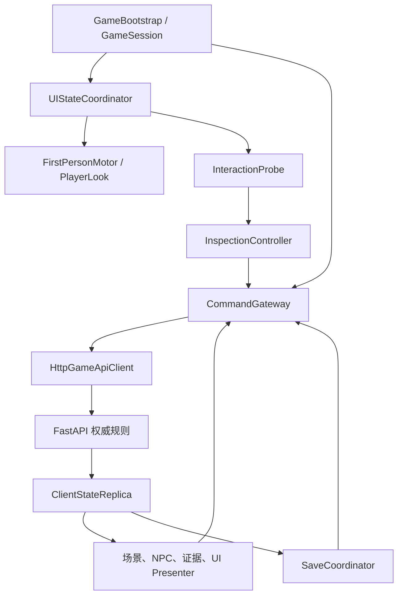
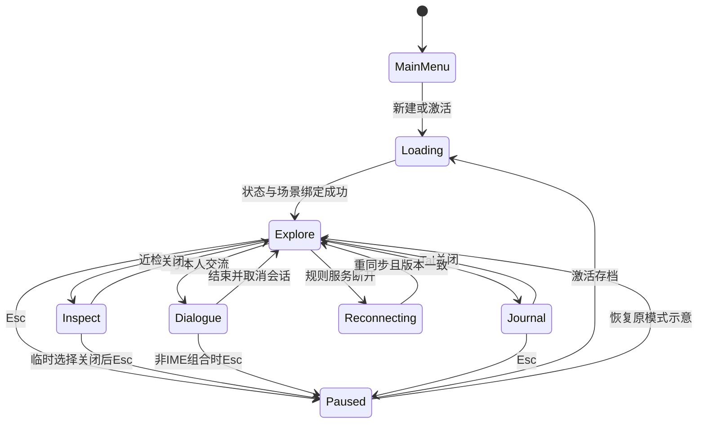
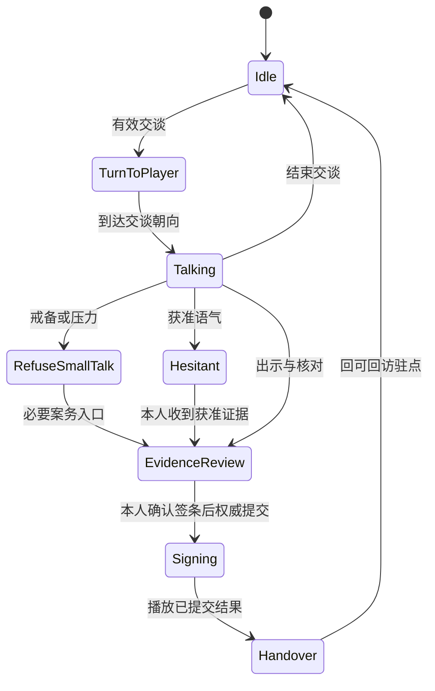

# 技术设计文档

待补充。

---

# Unity 客户端技术设计：第一章垂直切片

日期：2026-11-21。阶段：3，提交技术设计审查。唯一主笔：Unity Engineer。上方原始标题及“待补充。”保留为初始化历史；当前设计正文从本节开始。本文没有对应的已实现玩法代码或正式场景。

本轮用户确认的优先级为画面质量、沉浸和人物表现、玩法完整度、AI 体验、维护扩展。本文落实 [GDD](GDD.md)、[StoryBible](StoryBible.md)及[第一章原稿](Sources/HistoricalStory/chapters/chapter_01.md)，不更改 F/E/D/R/A 的故事条件。部署与状态权威见 [Architecture](Architecture.md)，所有 HTTP 路径、ID、JSON 字段、错误码与事务规则以 [DataSchema](DataSchema.md)为唯一规范；本文件不另建一套协议。

## 1. 已核实基线与方案选择

| 项目 | 当前证据 | 本轮设计处理 |
| --- | --- | --- |
| 引擎 | ProjectSettings/ProjectVersion.txt：6000.3.29f1 | 锁定当前工程，不升级 |
| 渲染 | manifest 与 packages-lock：HDRP 17.3.0 | 沿用现有 HDRP 配置；改画质参数须后续单独授权 |
| 输入 / 摄影 | Input System 1.20.1；Cinemachine 3.1.7 | 新输入系统动作，Cinemachine 3 相机；不引用 CM2 API |
| UI / 导航 | uGUI 2.0.0，含 TMP；AI Navigation 2.0.16 | 单 EventSystem + InputSystemUIInputModule + TMP；NavMesh 仅用于人物短距移动 |
| 其他直接依赖 | Timeline 1.8.13、ProBuilder 6.1.4、Visual Scripting 1.9.13、Collab Proxy 2.14.0、Multiplayer Center 1.0.1、Development Feature 1.0.2、UI Test Framework 6.3.0 | 依赖存在不等于系统已用；切片不引入多人、Visual Scripting 或新基础框架 |
| 工程现状 | Assets/_Project 主要是目录、.meta 与 .gitkeep；Build Settings 当前仅有 Assets/OutdoorsScene.unity；有模板 TutorialInfo 脚本 | Bootstrap/MainMenu/Station 都是未来设计路径，不能声称已可运行；现模板场景保留 |
| 可复用资源 | 既有 InputSystem_Actions.inputactions、中文字体与 SDF、HDRP High Fidelity/Balanced/Performant 资源 | 先审内容和 GUID，再决定显式引用；不覆盖、不复制同名资源 |
| 后端 | Server/requirements.txt 只有依赖说明，无游戏后端 | M3/M4 可用契约测试替身显示流程；不得把替身当第二套正式规则 |

方案取舍：

- 玩家采用 CharacterController，避开 Rigidbody 移动对普通调查碰撞、坡面和镜头产生的非必要物理耦合；本作没有跳跃战斗。CharacterController.Move 不自动施加重力，运动模块自行处理重力与接地。[Unity 6000.3 Move 文档](https://docs.unity3d.com/6000.3/Documentation/ScriptReference/CharacterController.Move.html)
- 第一章采用一个 Station 内容 Scene 内连通三区，异步加到常驻 Bootstrap。相比三区分别流式加载，便于先统一人物回访、天气、光照过渡与状态恢复；相比把全部 UI/服务放入 Station，常驻外壳避免换场景重复网络会话。以后仅在实际内存/加载证据支持时拆分，不提前安装 Addressables。
- 客户端是表现与交互采样端；FastAPI 是证据、知识、关系、推理、保管、章节和存档的唯一权威。原始位置/射线结果在本地单人游戏中是体验层的可信报告，不是防作弊证明。
- 先用 Inspector 显式依赖和少量纯 C# 服务组合，不加容器、ECS、全局事件总线或另一个规则引擎。高质量人物与场景不依赖技术层数。

## 2. 模块、依赖与接口职责

依赖向下，数据向上返回。Presenter 读只读投影、发意图；不能拿到可修改的游戏状态集合。MonoBehaviour 只负责 Unity 生命周期、视图和输入桥接；条件计算不散落在 Collider、Button 或 Animator 回调内。

| 模块 / 未来目录 | 输入与输出 | 明确职责和边界 |
| --- | --- | --- |
| Core/GameBootstrap、GameSession | 引用配置、会话建立结果 → 当前存档上下文 | 启动组装、服务生命周期、唯一当前 save/runtime、场景切换入口；不判故事条件 |
| Core/ClientStateReplica | GET state 的合法 PlayerStateView → 不可变只读投影、Changed 通知 | 仅按完整视图替换投影；普通 commands 结果不是状态 patch；断线可读，不保存作者 F 全文、不自增证据 |
| Core/CommandGateway | 获批意图 → 单写队列、服务器结果 | 生成 request_id、携 runtime 与版本、去重、冲突重同步；不把失败重试变成新动作 |
| Player/FirstPersonMotor、PlayerLook | 当前允许的 Move/Look → 控制器位移和镜头目标 | 接地、碰撞、平滑、视角；被模式层锁定即停止 |
| Interaction/InteractionProbe、InteractableView | 摄像机射线、距离、对象注册 → 唯一候选及提示 | 遮挡、可达、有效动作筛选，提示不发证 |
| Interaction/InspectionController | 部位选择、旋转缩放 → item.inspect 意图、近检视图 | 五部位观察，视图复位，部分完成可重入；证据由服务器派生 |
| Evidence/EvidencePresenter、EvidenceViewCatalog | PlayerStateView 的可见卡、局部观察与获准 media_refs → 证据卡/影像 | 仅显示 visible_evidence_records、observed_fields 与 journal_fixed_entries；Catalog 只解析获准表现引用，不内置整套作者正文；保管变化不销毁卡片 |
| NPC/NPCPresentationController、NPCNavigationAdapter、NPCGazeController、NPCAnimationBridge | 人物可见状态和已提交表现提示 → 动画/移动/目光 | 不从情绪推断说谎，不向另一个 NPC 复制知识，不以动画事件写权威 |
| Dialogue/ConversationController、DialoguePresenter | 当前 NPC、topic/text、获批关键段 → 对话界面 | 会话取消/轮次/草稿、202 轮询及回复校验；不让自由输入直接触发 D |
| Investigation/ReasoningPresenter | 已持证据、命题 ID → reasoning.submit | 排列/选择、缺项反馈、重看；不调用模型判断成立 |
| UI/*Presenter | Replica + UI 模式 → 15 类界面 | 仅显示玩家当前可见内容，统一键鼠消费与视觉层级 |
| AI/HttpGameApiClient | 规范 DTO → UnityWebRequest 传输结果 | 序列化、超时、取消、协议/格式错误；不含模型 Key 或供应商 SDK |
| Save/SaveCoordinator | 保存/激活请求 → 事务快照和安全重建 | 调后端 checkpoint/activate；本地只有设置和短期草稿，不写游戏真相 |

未来可将协议 DTO、传输、表现分别设程序集，拆分前以引用图验收。当前阶段只记录边界，未创建 .asmdef。HTTP PlayerStateView 的 checked_parts、item_custody 等采用 DataSchema 规定的显式类型数组，内部 SQLite 快照可以使用不同形状，客户端不能解析内部快照。typed 数组简化映射，但不能替代严格协议校验；网络边界采用下节的分层解析设计。

### 2.1 严格 JSON 边界与依赖门槛

**选型：推荐官方 Unity 包 com.unity.nuget.newtonsoft-json，M0 后须单独批准，当前未安装。** 当前 manifest/67 项 lock 没有该包，也没有可直接承诺使用的独立 System.Text.Json 包。2026-11-21 核对官方 3.2 文档页面显示 3.2.2，仅列为候选；准确兼容版本、许可证和后续 Packages/manifest.json、packages-lock.json 的修改授权为 [待确认]，不能把文档可查当已锁依赖。[Unity 官方 Newtonsoft 包](https://docs.unity3d.com/Packages/com.unity.nuget.newtonsoft-json@3.2/manual/index.html)

JsonUtility 会忽略未映射字段，也不提供本契约需要的必填成员存在性校验；缺字段不能依靠返回对象中的默认值/既有值判为有效。因此不把它作为 HTTP 输入验证器或更新 Replica 的入口。显式数组只解决形状问题，不能保证拒绝未知/缺失/错型。也不以简单 JsonConvert.DeserializeObject 就宣称满足严格契约。[Unity JSON 序列化说明](https://docs.unity3d.com/6000.3/Documentation/Manual/json-serialization.html)

收到响应后的唯一处理链为“有限字节读取 → 有限深度 JToken 解析 → 按端点/命令对应结构递归校验 → typed DTO 映射 → save/runtime/版本与可见性校验 → 原子替换 Replica”。解析器和校验器放入 HttpGameApiClient 的边界组件，所有 Presenter 只拿校验通过的类型，不能自行 FromJson 旁路。

| 顺序 | 可执行校验要求 | 失败结果 |
| --- | --- | --- |
| 1. 读取上限 | 限制实际接收字节，不能只信 Content-Length；UTF-8 严格解码。请求体限值沿用 DataSchema；响应上限建议 256 KiB、嵌套最大深度建议 32，二者为 [待确认]，需 M0/M5 以完整首章投影与超限用例确认 | 超限、非法编码在构造大型对象前中止；不清空旧镜像 |
| 2. 安全解析 | JsonTextReader 设置有限 MaxDepth、DateParseHandling.None；通过带 JsonLoadSettings 的 JToken.ReadFrom 解析，DuplicatePropertyNameHandling.Error，禁止重复键的默认覆盖。读完根后再确认无第二个根/多余非空内容；CommentHandling.Load 保留评论 token 后拒绝，拒绝 Undefined、Constructor、Raw 等非契约节点 | 结构错误、深度越界、重复键、尾随内容拒绝；保留旧镜像 |
| 3. 成员集合 | 按已发请求的端点与 command_type 选择固定响应结构，逐层按大小写敏感的白名单比较成员；验证所有 required 字段存在。成功/失败 envelope 分支分别校验 data/error，允许 null 仅限 DataSchema 明列字段。数组必须实际为 Array，不把 null 当空数组 | 未知字段、漏字段、错误分支、非法 null 拒绝；不能补默认值使其“通过” |
| 4. 精确 token 类型 | state_version/event_seq 等只接受 Integer，范围 0–2^53-1；字符串数值、布尔、1.0/1e0 不当整数。Boolean 不能用 0/1；UUID、枚举、UTC 时间按 String 再检查格式。实际浮点字段仅接受有限数值与各自范围；NaN/±Infinity 或溢出直接拒绝，不转字符串兜底 | 错型、数值越界、精度损失和未知 ID 拒绝；不依赖 DTO 自动强转 |
| 5. 引用和完整视图 | 按 DataSchema 检查 typed 数组字段、唯一 evidence/item/field ID、当前 content_version、枚举及互相对应；PlayerStateView 缺 visible_evidence_records、observed_fields 或 journal_fixed_entries 等必填项即失败。内部 snapshot/作者状态不按玩家 DTO 接收 | 不把不完整响应当补丁、不加载隐藏正文；旧投影仍可只读 |
| 6. 映射与应用 | 前验通过后映射显式 DTO；JsonSerializer 仍设 MissingMemberHandling.Error、TypeNameHandling.None，必需成员用 Required.Always，必需可空用 Required.AllowNull；不接收任意多态类型，不加载外部元数据。DTO 映射出错继续拒绝。最后才按第 8 节验证身份/版本并一次替换 Replica | 不创建半新半旧对象，不产生默认“已取证/已通过”值 |

MissingMemberHandling.Error 只处理 JSON 中多出来、类型没有对应成员的字段；Required 只处理存在/可空约束，都不单独保证原始 token 类型。重复键的默认行为也是覆盖，所以必须显式启用 Error。上述递归前验不能省略或以降低 U02/API16 断言替代。[缺失成员处理](https://www.newtonsoft.com/json/help/html/DeserializeMissingMemberHandling.htm)、[Required 约束](https://www.newtonsoft.com/json/help/html/T_Newtonsoft_Json_Required.htm)、[重复键处理](https://www.newtonsoft.com/json/help/html/P_Newtonsoft_Json_Linq_JsonLoadSettings_DuplicatePropertyNameHandling.htm)、[读取深度限制](https://www.newtonsoft.com/json/help/html/P_Newtonsoft_Json_JsonReader_MaxDepth.htm)

校验器是针对本项目 DataSchema 的有限 DTO/字段表，不自写通用 JSON 解析器，不另引收费 JSON Schema 库。若该候选包未获批准，网络接入里程碑保持阻塞，或由 Director 提交经验证的等价方案后再决定；不能悄悄安装，也不能为零依赖退回宽松解析。获准版本安装后，先以 TestPlan U02/API16 的正常、未知/重复键、漏 required、错型、null、NaN、过深及内部快照误投输入运行 EditMode；Windows 选定脚本后端还需验证该准确包、DTO 保留与裁剪。当前只完成设计，不宣称这些测试已执行。

## 3. 玩家控制、焦点与暂停

### 3.1 移动与摄影

探索输入为 WASD 平面移动、鼠标视角、E 交互、Tab 手册、Esc 暂停。按斜向输入归一化，避免对角加速；移动沿玩家水平朝向，俯仰只改视角。CharacterController 负责与站内碰撞面约束；运动模块在接地时清理向下速度，未接地时施加重力，不允许玩家爬过安全隔绳。碰撞壳与可达路径一起测试。

第一人称相机跟随专用眼高目标。一个真实 Camera + CinemachineBrain；探索、对话构图、交接可以用不同 CinemachineCamera，只有当前模式驱动其目标；PlayerLook 与 Cinemachine Input Axis Controller 不同时写同一轴。近检使用独立 RenderTexture 预览相机，不承担世界交互射线和全局 AudioListener。相机转场不强制玩家大幅旋转，不把景深当调查门槛。[Cinemachine 3.1 Camera 文档](https://docs.unity3d.com/Packages/com.unity.cinemachine@3.1/manual/CinemachineCamera.html)

初始调参建议而非已批准指标：移速 1.5 m/s、视线俯仰 ±80°、垂直 FOV 60°、眼高 1.65 m、物件交互 1.8 m、人物交谈 2.2 m，均为 [待确认]。推荐在 M2 按站内尺寸和两名角色身高做一次体验取样，确认值写入配置与测试用例；不能把建议数值反推人物身高或场景事实。

### 3.2 唯一输入拥有者

图中恢复箭头仅示意，实际保存进入暂停前的模式与其焦点对象；恢复 Dialogue/Inspect/Journal 时回原界面，不一律退探索。文本焦点是活动 UI 模式上的子状态，不能成为第二个可并行的输入地图。

| 模式 | Gameplay Move/Look/E | UI 指针 | 文本与全局键 |
| --- | --- | --- | --- |
| Explore | 启用，且无其他输入锁 | 光标隐藏并锁定 | Tab/ Esc 由模式协调器独占 |
| Inspect | 禁用 | 可见，拖拽只旋转预览物 | Esc 先取消未确认选择；不自动提交检查 |
| Dialogue / Journal | 禁用 | 可见，限制在当前界面 | 文本框有焦点时 W/E/Tab/Enter 归文本；无组合输入时才可点明确提交 |
| Paused / Loading | 禁用 | 菜单可见 | 不发权威动作；恢复/取消按菜单路由 |
| Reconnecting | 禁止权威交互；允许看已存手册 | 可见，重连界面 | 不自动本地判案；重连后重新获取投影 |

UIStateCoordinator 计算模式栈和显式输入锁，统一启停 Gameplay 与 UI Actions。切换入 UI 的同一帧先关 Gameplay，再选择 UI；返回前清空缓存 Move/Look 值并等待触发切换的键释放，防止关手册的 Tab 或输入法 Enter 穿透成下一动作。失去窗口焦点自动进入安全暂停、清运动量并释放光标，回焦点经用户继续才重锁。

Unity 不会自动阻止 UI 与游戏共同消费同一点击，因此不以“点击在面板上”作为唯一输入隔离。Pointer-over 判断只作附加检查，不能在 InputAction 回调中依赖尚未更新的 UI 状态。[Input System 1.20 输入冲突文档](https://docs.unity3d.com/Packages/com.unity.inputsystem@1.20/manual/handling-input-target-ambiguity.html)

### 3.3 中文 IME 与暂停异步边界

采用 TMP_InputField 和 InputSystemUIInputModule 的正式文本输入通道，不用按键拼接汉字，不重复订阅字符造成双输入。只要输入框取得焦点，Gameplay 整张 Action Map 都关闭；不是等 IME 出现非空组合串才关。监测 Keyboard.onIMECompositionChange 用于阻止组合中的 Enter 提交或 Esc 退出，但不能假设所有 IME 都会用空串报告结束；以输入框提交/失焦和候选处理结果共同恢复。UI 的 Tab/Enter/Cancel 由统一路由避免与输入框竞争。候选窗口坐标、粘贴、多行、退格、焦点切换在真实 Windows 微软拼音下验证。[Input System 1.20 文本输入文档](https://docs.unity3d.com/Packages/com.unity.inputsystem@1.20/manual/read-keyboard-text-input.html)

本轮暂停采用显式停止运动/人物调度/演出计时和游戏音频组，UI 与 HTTP 管理使用非游戏时间；不依赖 Time.timeScale=0 停住网络，也不让 Time.timeScale 决定权威事务。进入暂停后不新发写命令、不展示迟到 AI 段。已到服务器的命令不保证被取消：结果可能已提交，先记录待重同步；恢复时 GET state 后重建，再决定可否展示。读档必须先关闭文本焦点、取消本地请求和演出，再通过服务器 activate 建立新 runtime。

## 4. 场景、区域与状态恢复

### 4.1 未来 Scene 组织

| 未来路径（均在 Assets/_Project/ 下） | 单一责任 | 加载与退出 |
| --- | --- | --- |
| Scenes/Bootstrap/Bootstrap.unity | 常驻 GameBootstrap、UI 根、唯一 EventSystem、会话与网络服务 | 首启动；重复装入要检测并拒绝第二份服务 |
| Scenes/MainMenu/MainMenu.unity | 菜单背景与菜单表现，不持有游戏权威状态 | 与 Station 内容互斥 |
| Scenes/Station/Chapter01Station.unity | LostProperty、WaitingHall、PlatformSafe 三根，建筑、天气、NPC 驻点与交互点 | Bootstrap 用 LoadSceneAsync 加载，绑定完成前不给玩家控制；切回菜单时卸载 |

这些路径仅用于后续文件分配，当前没有这些正式 Scene。既有 OutdoorsScene 及所有 .meta 保留；Build Settings、ProjectSettings 和共享 HDRP 设置的后续更改需 Director 针对具体文件另行授权。不能用手工 Scene YAML 生成代替 Unity 编辑工作流。[Unity 异步场景加载文档](https://docs.unity3d.com/6000.3/Documentation/ScriptReference/SceneManagement.SceneManager.LoadSceneAsync.html)

Station 区域连接为失物招领处 ↔ 候车大厅 ↔ 站台安全内侧；东休息室、西窗和档柜是既有区域位置。第一章地图只登记第一章允许的交互与台词。磁带套、封票袋可作已批准背景，但 E06 以后不对切片开放，不靠隐藏碰撞删除其存在。

每个可恢复对象使用稳定内容 ID，对应 DataSchema 的区域、物品与 NPC ID；不将 Unity instanceID、Hierarchy 顺序或场景对象名字作为存档主键。InteractivityRegistry 在场景加载时检查重复/缺失 ID，失败时阻止写交互并给开发诊断，不能随意重建 GUID。

### 4.2 加载与恢复流程

1. 进入 Loading；停止输入，冻结当前表现，将旧 Conversation 标为不可显示。
2. 请求新建/activate；确认新 save_id、runtime_id、state_version 与内容版本可理解。加载对应内容 Scene。
3. 注册角色、物件、驻点、近检预览和证据表现资源；校验第一章全部必需 ID 与字库。
4. 获取完整只读投影；按 ItemCustody 决定怀表原物在台面、待核袋或林遥保管表现。已获得影像卡单独重建。
5. 恢复玩家有效区域与安全锚点、NPC 当前获批驻点和知识相关的表现；不恢复 Animator 半帧或未完成 HTTP 请求。
6. 正常完成后返回 Explore。缺资源/坏位置只回到同区域安全锚点并提示，不清空案件；内容版本或关键对象不匹配时保持阻止状态，交给恢复界面处理。

玩家与 NPC 路径分离：玩家用 CharacterController 和建筑碰撞；NPC 用既有 AI Navigation，站内短距 NavMeshAgent/指定交谈锚点，避免随机巡逻挡住关键交互。老周驻大厅清点桌，林遥驻西窗旁；去核对台的路径失败时不发交接命令，允许重新就位，不把证据锁在不可达角色身上。[AI Navigation 2.0 文档](https://docs.unity3d.com/Packages/com.unity.ai.navigation@2.0/manual/index.html)

推荐环境静态照明、局部动态人物/道具补光、反射探针与 HDRP Volume 分区；Station 统一天气管理雨幕、檐下排除、音频干湿过渡。天气只改表现，不能重新演一场停电产生新证据；跳闸/补照历史时点仍只能由 E02/E05 支撑。灯光、雾、LOD 与质量档的制作和后续授权见 [VisualDirection](VisualDirection.md)。

## 5. 交互检测与怀表近检

### 5.1 聚焦、提示和高亮

每帧在 Explore 从当前世界相机中心作有限距检测；过滤自身碰撞体后按距离处理最近阻挡物。只打 Interactable 专用层而忽略墙壁会透墙，必须同时包含实体遮挡；如果无现有专用层，可用组件注册和普通碰撞层筛选，不为实现检测擅改 TagManager。Trigger 默认不作为实体阻挡，特殊交互触发体需白名单。

候选对象还需满足区域已开、对应动作可用、玩家距离与人物距离、面对朝向、非系统忙碌、无遮挡。稳定候选才显示名称/E 提示；点击 E 时重新检测，避免 NPC 转身后对旧对象提交。高亮是轻微对象轮廓或焦点标记并附动作文字，不透墙、不改变证据表面颜色；需要自定义 HDRP Pass 的轮廓方案保留为 [待确认]。推荐第一版用屏幕焦点环 + 受控材质反馈满足可辨认性，避免为提示修改全局渲染设置。

对大量检测结果使用可复用缓冲；缓冲满则保守拒绝交互并报告诊断，不能从被截断列表里任选对象。交互提示不等于服务器已接受动作；点击后短暂禁用同按钮，不隐藏其他调查入口。

### 5.2 近检状态与部位登记

近检从 InteractableView 取展示资源，生成专用预览实例；原物在世界中的可见性由保管投影决定，不能把原物从场景拖走作为证据。预览有固定柔光和中性背景，视角、缩放均有限制与复位。旋转只作用预览根，不更新 ItemCustody。进入近检先经 scene.interact 的 begin_interaction 取得绑定目标的 interaction_token；这个访问上下文在连续检查过程中不会因每次 state_version 递增失效。

退出近检先本地禁止继续使用 token，再发 scene.interact 的 close_interaction（携 area_id、target_id、interaction_token）。这只关闭访问上下文，changed=false、不增加游戏状态版本；切换新目标、会话 cancel、activate 与服务重启同样按 DataSchema 撤销旧 token。close 因断线未送达时不能继续用本地缓存 token，服务端另以建议的 60 秒无活动期过期，[待确认] 随交互时延验证。已经提交的检查不会因为关闭预览被追溯撤销。

| 部位 ID（DataSchema 规范） | 玩家主动检查与可见内容 | 权威登记边界 |
| --- | --- | --- |
| dial | 对准表盘并点“检查表盘”，读九点十七分 | 不凭此证明昼夜、坠落时点或主人 |
| back_engraving | 翻背检查 0412·0916 | 辨认特征，不是领取授权 |
| serial_number | 对准 QH-283 钢印并确认 | 可按编号查同号单据 |
| side_crown | 观察侧冠凹陷 | 仅观察现有外观，不自动推出原因 |
| crown_shaft_damage | 检查可见冠轴偏斜和已有损伤 | 不自行拆修或让玩家“修好”证据 |

每次部位点击发送 item.inspect；旋转/悬停不是完成。服务器逐个保存 InspectionState，五部位齐全才派生 E01；未齐时手册显示已查字段和未查部位，不显示完整 E01 或 R01/R02 资格。重复部位不重复发卡。E01 完整固定文字、E03/E04/E05 的真实获取条件以 [剧情映射](Chapter01ImplementationMap.md)与来源矩阵为准。

旋转缩放不写权威；已确认检查标记必须后端确认才常亮。最后部位的响应丢失，保留相同 request_id 重试/查询状态，不能再次生成一张 E01。打开原物、发证据、登记照片的具体命令均沿用 DataSchema，不允许发送任意 evidence_id 就取得证据。

证据照片采用已批准的稳定角度资源或验证过的现场截图作为展示；固定文字/编号是可读信息主渠道。显示只依据服务器给的 media_refs；若一张图拍入尚未检查部位或未读文书，必须使用获准裁切/遮挡版本，不能先装入完整秘密图再只靠 UI 裁切。照片生成失败不能丢失已提交 E01，改用固定来源影像；后续只改变保管原物，不删除 EvidenceRecord、部位标记、照片引用或推理资格。仍可从手册的已检查影像视图回看；不需要让林遥掏表出来才能做 R02。该回看不新增观察或替代未完成部位检查。

## 6. 两名 NPC：表现与状态隔离

第一章主要活动 NPC 为 npc_laozhou、npc_linyao；许澄的后续角色资料不作为此切片必须完成的第三套正式人物资产。

### 6.1 表现状态与动画

表现子状态没有权威剧情副作用。NPCPresentationController 接收本人状态和已批准的表现提示；AnimationBridge 设置 Animator 参数并防重播，GazeController 管头眼朝向、最大旋转与回正，NavigationAdapter 只到预置锚点。不能由 LLM 输出任意 Animator 状态名、骨骼路径或移动目标。

| 动作 | 技术分配 | 中断与恢复 |
| --- | --- | --- |
| 待机、整理物件 | Animator 基础层与局部手势 | 不移动真实证据，不自动交接 |
| 走动、转身 | NavMeshAgent 驱动根 + in-place 步态；转身受限 | 不与 root motion 同时写根，停止后对齐锚点 |
| 注视玩家 | 现有骨骼/Animator IK 能力作局部受限权重 | 无目标/离开范围时平滑归位，不增加 AI Rigging 包作为前置 |
| 说话、迟疑、回避 | 获准 visual enum → 嘴形/表情/上身动作 | 关键句固定；没有配音时字幕与自然待机仍完整 |
| 拒绝闲聊 | 关闭可选自由闲聊表现，但保留案务按钮 | 不随机离站，不让关系堵死主线 |
| 证据核对 | 目光/手势指向显示给本人的文件 | 只展示获批字段，不把整 F 表或他人状态传给角色 |
| 签字/交接 | 显式签条确认后提交原子事务，成功后播放 | 失败/读档/丢帧从最终保管投影重建；AnimationEvent 不发证、不判章末 |

Animator 局部约定为 speed(float)、turn(float)、is_talking(bool)、emotion(int，允许的表现枚举)、gesture(trigger)。presentation_id 是表现控制器的本地序号，用于避免重放一次性动作，不等同 HTTP 请求/事件 ID。具体嘴形、表情和动作资源由 Art 验证骨骼后定稿；服装/肖像仍按 VisualDirection 处理。

### 6.2 对话、知识与固定披露

每个角色绑定独立 ConversationSession 和当前可说投影，不能用全局“玩家拿到 E04”直接改变林遥的 Animator 或台词。K/H/B/L/N 分类在服务端执行，Unity 不加载作者私密事实作为本地模型上下文。

- D01：向老周出示 E02 后才修正 B01。表演可呈现看卡、停顿、纠正，不改变林遥。
- D02：E03+E04 后选择具体核对人。只向老周核对，只更新他的披露/记忆；林遥本人看单并核对才记录她的授权知识。R01 通过本身不代替她核对。
- D03：E01+E05 后追问老周，允许亲历拾表与冠轴说明，不新增超出 E05 的证据。

关键证词独立显示固定文本段，AI 可在前后加非案情衔接；正文与证据栏分开，生成段不能被拖入证据板。生成回复校验失败时整段替换获批回退，固定披露不等待模型。不做“紧张=说谎”指示。

### 6.3 A02 交接事务与表现

先检查可用路线与站位、展示回执及保管选项，这些是可撤销准备。暂交须 E01、R01、林遥本人 D02 完成，玩家在可见的今夜暂收条上明确确认；装袋仅须 E01。用户确认后执行 choice.commit，保管、签认回执、A02 和第一章完成/CH02 资格在同一后端事务提交。只有成功投影到达后才播放最终入袋/收入衣袋动画。

请求处理中锁定该选择与读档入口，仍可提示“正在记录”。通信超时不能假设失败而把表弹回台面；查询/重试相同请求，以 state 决定最终位置。服务器提交后动画损坏只退到最终静态持物表现，不撤销已签记录。客户端崩溃在动画前，下次重建同一合法保管状态，不重发签条、不再加关系。准备动作中取消不产生 A02；确认提交以后退出界面不构成业务撤销。

第一章结束条件始终是 E01+A02，不把 R01/R02/D01/D03 全部完成作为强门槛。切片在章末提供“继续调查/返回菜单”及 CH02 可开放状态；不实现第二章内容，也不伪装为三种全剧结局。

## 7. 15 类 UI 的控制与视觉层级

采用 uGUI Canvas + TMP 及已存在的中文 SDF，单 EventSystem/单 UI 输入模块。层级从环境/HUD、对象提示、主调查面板、临时选择、暂停/加载依次提升；每层有明确背景遮挡和输入阻断。视觉规范见 VisualDirection，不使用管理后台式数据表和满屏按钮墙。

| UI | 主要内容与表现 | 交互约束 |
| --- | --- | --- |
| 主菜单 | 车站背景、新建/继续/读档/设置 | 规则不可用时可进设置/退出，不伪造新存档 |
| 暂停菜单 | 继续、保存/读取、设置、返回菜单 | 记住原层，不在背后提交推理 |
| HUD | 克制准星、当前调查目标、短暂状态提示 | 不展示作者 F、信任数值或全答案 |
| 交互提示 | 对象名 + E/检查动作 | 遮挡/距离失效即撤销，不能透墙提示 |
| NPC 对话 | 人物脸/手优先；姓名、固定关键段、非关键衔接分层 | 切换人物先关闭旧 Session |
| 自由输入框 | 中文输入、草稿、明确发送、等待/取消 | 焦点关闭全部 Gameplay；默认正文只保留内存 |
| 预设话题 | 当前可用话题与必要案务 | 模型断线仍可用，不显示未开放的秘密关键词 |
| 证据出示 | 当前可引用物证/字段与接收人 | 只能选择已登记来源；不把持有等同已出示 |
| 物品检查 | 大幅 3D 预览、旋转/缩放/复位、部位提示 | 信息文字位于反光区外；点击部位才登记 |
| 调查手册 | 证据/证词、当前任务与来源 | 读离线镜像只看已知，不改权威 |
| 关联/推理 | 选择证据卡、命题和提交 | 失败保留选择并给已知缺项，不扣关系 |
| 人物档案 | 已确认身份、实际给出的证词与修正 | 隐藏作者秘密和未获知识，不能展示 H/N 全表 |
| 关系反馈 | 称呼、姿态、简短交谈反馈 | 不把关系条当证词真伪或领取资格 |
| 章节交接 | 已核/待核、A02 保管回执、继续调查 | 不因关窗自动交接；CH02 内容不属切片 |
| 设置 | 音量、画质、字幕、文本倍率、FOV/灵敏度等已批准项 | 画质切换不改物证资格，实际可支持项目经实现确认 |

证据卡视觉优先级为编号/标题 → 原始记录 → 来源/范围 → 玩家关联；短摘要不替代全文。对话的固定证词有可回看标识，生成段无“已证实”外观。物件近检尽量让实物占主要画面，侧栏展示当前字段，绝不把完整 E01 在首次打开时全部印出。

手册与界面恢复从 GET state 的三个必填 typed 数组重建：visible_evidence_records 提供已登记卡的固定正文、来源、证明范围及影像引用；observed_fields 提供已主动检查的局部文字，E01 未合成时也可只回看表盘；journal_fixed_entries 提供真正已入册的本人固定证词、出处和修正状态。新档三数组为空；未持卡不显示完整卡正文、未检查字段或作者 F/H/N。客户端不以裸 E ID 为由下载整套作者目录，也不从未来分支 ConversationMessage 扫描补回旧证词。

显示分辨率、文本倍率与安全边距的建议测试组合见 TestPlan。缩字不能成为避遮挡的默认方案，优先重排/滚动；至少验证 1280×720、1920×1080、2560×1440 与 16:10/超宽布局的目标范围，最终支持范围为 [待确认]。证据正文不依赖后期特效、色差、听力或头部追踪。

## 8. HTTP、并发、取消与读档

### 8.1 统一命令入口

客户端只使用 DataSchema 中版本化 API。权威动作统一 POST /api/v1/saves/{save_id}/commands，携 request_id、save_id、runtime_id、state_version、command_type、payload；标准响应携相同上下文、当前 state_version、changed、data、error。本文不复制示例 JSON 以免形成第二协议，E01/NPC/R01/存档的完整可解析示例见 DataSchema。

| 客户端意图 | 规范入口/命令 | 客户端不得做的事 |
| --- | --- | --- |
| 打开失物包、按索引翻档、进入/关闭对象 | scene.interact：open_package / begin_interaction / close_interaction 等白名单动作 | 用位置直接 grant E；关闭后继续使用旧 token |
| 指定部位检查 | item.inspect；必要时 evidence.register 补登 | 随便传 E01 绕过五部位 |
| 出示与追问 | npc.present / disclosure.trigger | 给甲出示后广播乙已知 |
| 选择命题 | reasoning.submit | 用本地布尔值或 LLM 判断 R |
| 关系态度/保管选择 | relationship.act / choice.commit | 传信任增量、直接 set ItemCustody |
| 章节状态同步 | chapter.advance 仅验证已有条件 | 任意 set chapter=2 |
| 保存/读取 | checkpoints / activate | 直接写本地证据 JSON 当正式存档 |

CommandGateway 在一个活动 runtime 内串行发送写命令，按钮只生成一个待处理意图；commands 响应的 data 只是命令结果，不携完整投影。changed=true 后先将响应版本设为同步目标，再 GET state 取回完整 PlayerStateView 并应用，成功后才能开放下一写动作或播放依赖新状态的交接。查询与 AI 轮询可并行，但不能提交依赖尚未完成结果的新写动作。服务器仍需版本比较和事务锁，不能只依赖客户端排队。

### 8.2 响应接受规则

普通响应必须通过 save_id、runtime_id、request_id 和所属会话/轮次检查。旧 runtime 响应不进入 Replica。成功命令可能返回提交当时版本，若低于当前 Replica 则只用于确认该请求完成，不把投影回滚；只从同 runtime 的 GET state 接受完整投影，不能用 event_ids、registered_evidence_ids 等局部结果自行拼权威状态。state_version 相同的无变化结果不重复播放动画。

activate 成功后更换 runtime_id，并使用当前高水位之后的 state_version；恢复旧 checkpoint 不回退 API 版本序号。客户端以待处理管理 request_id 识别这一特例，接纳其返回的新 runtime 后再装入 player_state；先清理旧队列、旧会话/草稿关联与表现提示。普通 commands 的旧 runtime 幂等重试必须被服务器拒绝。activate 是换代特例：原请求响应丢失后，可按 DataSchema 的 operation_receipts 语义用同键重拿仍活动的新 runtime 成功结果，不能套用普通命令的先拒旧时代规则，也不能再次执行恢复。

若激活响应丢失且当前身份不明，认证后调用 GET /api/v1/active 只读查活动 save/runtime/高水位，再决定同键重试或重同步。若 health 的 service_instance_id 改变，旧令牌、响应和队列不可复用：重新握手，在没有活动时代时以 runtime_id=null、新 request_id 激活目标存档的最近提交状态，获得新 runtime 与更高版本。重连不能擅自恢复较老 checkpoint 丢弃最近已提交调查；读旧点必须由玩家明确选择。

请求响应异常至少分：业务前置不足（显示允许的缺项）、版本冲突（重同步后由玩家决定是否重新动作）、runtime 失效（停止旧会话）、格式/协议错误（回退并记录脱敏诊断）、服务断开（禁止写状态）。具体状态码与超时数值只引用 DataSchema。超时后若不知道是否已提交，保留同 request_id 和同 payload 重试，禁止随机新 ID 连发。版本冲突后重新发意图属于新事务，不自动沿用旧前提。

### 8.3 对话异步

conversations 建立 NPC 独立会话；turns 发 text 或 topic_id 获 202 后轮询。ConversationController 记录当前 conversation_id、turn_id、请求 runtime 与发问时状态版本。模型输出只返回有效的显示候选，不自带正式 E/D/R 资格；要核对仍由玩家执行固定案务命令。

D 事务直接将其固定片段及已存在旧证词的修正状态写入 Journal。非 D 固定话题文本在当前本人确已展示后，按 DataSchema 的 scene.interact / acknowledge_fixed_segment 提交 service 下发的 fixed_delivery_token、interaction_token 与获准 content_refs，成功再 GET state。此确认只登记“玩家听到的固定片段”，不增加 NPC 知识、关系、E/D/R/A 或章节；生成段和任意客户端自造 ref 均不得入册。关闭、读档或旧 turn 令牌失效，不能靠晚到确认补知；未成功入册的旧固定段可再次合法交谈取得，不偷偷持久保存全部自由聊天。

取消、换人、读档及关闭对话时，先本地失效显示 token，再调用 cancel；UnityWebRequest.Abort 只中止客户端传输，不保证服务端事务或模型任务未完成。旧任务完成也不能显示到新人物上。若等待期间权威状态变化，重新验证/丢弃候选，不能把超前或过期关键段拼到新状态。服务端取消不可达时保持本地失效，重连从 state 对齐。[UnityWebRequest.Abort 文档](https://docs.unity3d.com/6000.3/Documentation/ScriptReference/Networking.UnityWebRequest.Abort.html)

缓存草稿仅限活动 UI 内存，读档或离开存档时清除；正文不写 PlayerPrefs、运行日志或持久化客户端文件。诊断仅保留 request_id、错误类别、耗时、版本，不落原始自由文本或 Key。

## 9. 保存、故障与表现恢复

后端保存最近完整事务的证据/检查、NPC 知识和关系/事件、D/R/A、保管、章进度，具体结构见 DataSchema。Unity 仅上报允许的区域/安全位置及设置，玩家坐标通过有限值和已注册区域校验；不能借坐标更改剧情条件。正式存档由 SQLite 事务与 checkpoint 管理。

保存 UI 只能在权威命令已确认后生成 checkpoint；请求处理中保存时先等待/同步，不捕获半交接或 LLM 任务。保存失败显示失败，不覆盖最后有效 checkpoint；读取坏档提供明确恢复入口，不自动清空或新建覆盖。

| 故障 | 可继续内容 | 恢复动作 |
| --- | --- | --- |
| 云模型不可用 | 既有固定话题、出示、披露、推理与章末 | 固定关键台词与同条件动作，稍后可重开自由问答 |
| 权威后端断开 | 已保存手册、设置、退出；可以停在安全场景 | 禁止检查/发证/关系/交接，重连查询真实状态 |
| A02 提交成功但动画或客户端崩溃 | 已提交保管与照片资格 | 从 ItemCustody 重建，不重算关系/签条 |
| 场景对象或资源缺失 | 菜单/诊断与已有保存不受破坏 | 阻止受影响写交互，不默认为证据已取或已丢 |
| 检查照片缺失 | 固定文本和已批准影像替代 | 修复表现引用，不撤销权威证据 |
| 读档位置非法 | 当前档案状态仍保留 | 回同区域安全锚点；不能因此解锁区域 |

## 10. 后续实施文件边界与验证

下列均为拟创建文件/资源范围，只有用户批准后续里程碑并由 Director 分配具体清单后才能写入。Scene/Prefab 及其 .meta 的唯一集成者为 Unity Engineer；Art 提交 Art/Materials、Characters、Props、Environment、Audio、VFX 原始资源，由 Unity 统一集成。不得同时编辑同一 Scene。

| 范围 | 拟文件或资源 | 验收依据 |
| --- | --- | --- |
| Core | GameBootstrap、GameSession、ClientStateReplica、CommandGateway、UIStateCoordinator | 单会话、单输入拥有者、单写队列，版本不回退 |
| Player / Interaction | FirstPersonMotor、PlayerLook、InteractionProbe、InteractableView、InspectionController | 三空间可走、遮挡正确、五部位显式检查、IME 不穿透 |
| NPC / Dialogue | NPCPresentationController、NPCNavigationAdapter、NPCGazeController、NPCAnimationBridge、ConversationController、DialoguePresenter | 两 NPC 可回访、固定案务与表演一致、知识不串人 |
| Evidence / Investigation / Save / AI | EvidencePresenter、EvidenceViewCatalog、ReasoningPresenter、SaveCoordinator、HttpGameApiClient | E/R/A 权威来源正确，断线/重复/旧回复/读档可恢复 |
| UI / Scenes / Prefabs | 本文 Scene 表与 15 UI 对应视图，Player/NPC/Interactables 预制体 | 容易检读、回访与恢复；正式文件清单由 Director 在每里程碑冻结 |
| Tests | QA 独占 Assets/_Project/Tests 和 Server/tests | 对应 [TestPlan](TestPlan.md)，Unity 只提交需要测试的行为，不越界写 QA 文件 |

必须运行的后续验证：EditMode 验证模式切换、投影版本与协议 DTO；PlayMode 验证遮挡/距离、UI/IME、五部位与照片、NPC 交接/动画打断；API 集成验证重复命令/读档屏障/规则断开；Windows 构建中验证实际字体、拼音候选、鼠标焦点、暂停恢复和存档往返。性能和真实镜头舒适度必须在指定目标机上测，不能从文档或 Editor 截图推断通过。

### 未决参数登记

| 参数 | 推荐方案与理由 | 确认内容 |
| --- | --- | --- |
| 移速、FOV、眼高、交互距离 | 先按第 3 节小空间调查建议做 M2 测试，便于近物可读和人物舒适 | [待确认] 用户验收体验区间，Unity 记录最终配置 |
| 高亮表现 | 焦点环和克制材质反馈，避免新 HDRP Pass 前置成本 | [待确认] Art 比对整体视觉，是否确需新 Pass；需要时另授权配置 |
| 单 Station Scene | 第一章先整体加载，避免先做无证据的流式复杂度 | [待确认] 用户采纳架构；实测内存/加载超预算后再评估分块 |
| UI 支持范围、按键重绑定、控制器 | 先完整键鼠/中文；重绑定保留接口，不把控制器列为已实现 | [待确认] 用户确定发布支持范围 |
| NPC 骨骼/IK/口型 | 沿用获准 Humanoid 骨架与有限面部 BlendShape，额外插件经资源验证再定 | [待确认] 具体资源、许可证、配音与手指签字动作质量 |
| 后端启动/打包 | 与 Architecture 推荐的本地伴随服务对齐，不在 Unity 内复制规则 | [待确认] 用户采纳部署与后续打包方案 |
| 严格 JSON 包与边界限值 | 推荐官方 com.unity.nuget.newtonsoft-json（3.2.2 仅当前文档候选），JToken 前验后映射；响应上限候选 256 KiB、深度 32 | [待确认] M0 后单独批准准确包版本及 Packages 文件修改，冻结限值并在 M5 运行 U02/API16；未批准前不接入宽松解析 |

文中 Unity 6000.3、Input System 1.20、Cinemachine 3.1、Navigation 2.0 的官方文档及本地已安装包文档已用于核对 API 能力，包页面实际对应当前 1.20.1、3.1.7、2.0.16。资料核验不等于补丁版本上的集成验证，实际 IME、人物骨骼/导航、相机和异步行为仍须在 6000.3.29f1 的 Windows 构建实测。

本轮仅完成设计和只读核查，没有启动 Unity、修改包/设置、编写 C# 或运行 PlayMode、构建、真实 AI。执行顺序与依赖见 [VerticalSlicePlan](VerticalSlicePlan.md)；阶段 3 最终结论以 [审查报告](Stage3TechnicalDesignReview.md)及用户验收为准。

## 11. 后续 AI 与浏览器适配边界

2026-11-21，按用户新增赛事方向补充；完整差异、Provider 规范、通信、降级、Web 风险和顺序见 [Architecture 第 9 节](Architecture.md#9-魔搭模型接入与浏览器部署的后续约束)。当前 HDRP Windows 第一章方案继续使用，不切渲染管线、不安装包、不改场景或玩法。

- 后端统一 LLMProvider，优先预留魔搭 API-Inference、OpenAI 兼容服务与无网络 MockAIProvider；Unity 只调用既有 /api/v1，不持有模型 Key 或供应商 SDK。
- 将未来桌面进程/管道/loopback 启停放在 DesktopCompanionConnection，共享层仅依赖 IGameServerConnection；未来 RemoteWebConnection 只连接 HTTPS 远端 FastAPI，Web 编译路径不引用 Windows 进程 API。
- 调查逻辑、DTO、UI 行为不引用 HDRP 专属类型；HDRP 材质、Volume、灯光和雨效留在表现层。HDRP 不支持 WebGL，未来另行批准 URP 浏览器展示路径与资源适配，不承诺同一 HDRP Scene 直接导出 WebGL。
- 浏览器 HTTP 采用 UnityWebRequest 异步路线，显式非缩放计时检查 deadline；避免托管线程/Timer 超时及原生 sockets 依赖。中文 IME、Pointer Lock、音频启动、刷新恢复、AOT/JSON 裁剪与包体内存单独验证。
- Provider 替换不修改证据/披露/关系/推理/保管/章节/存档规则。模型不可用时固定入口继续；规则服务不可用时仍停止权威变更。Mock 不能让网页在后端断开时继续判案。

以上为首次实现时的低成本边界，不提前创建空目录、抽象类或第二 Unity 工程。当前尚无对应实现，Web 平台/资源/托管方案均按 Architecture 的 [待确认] 项执行。
