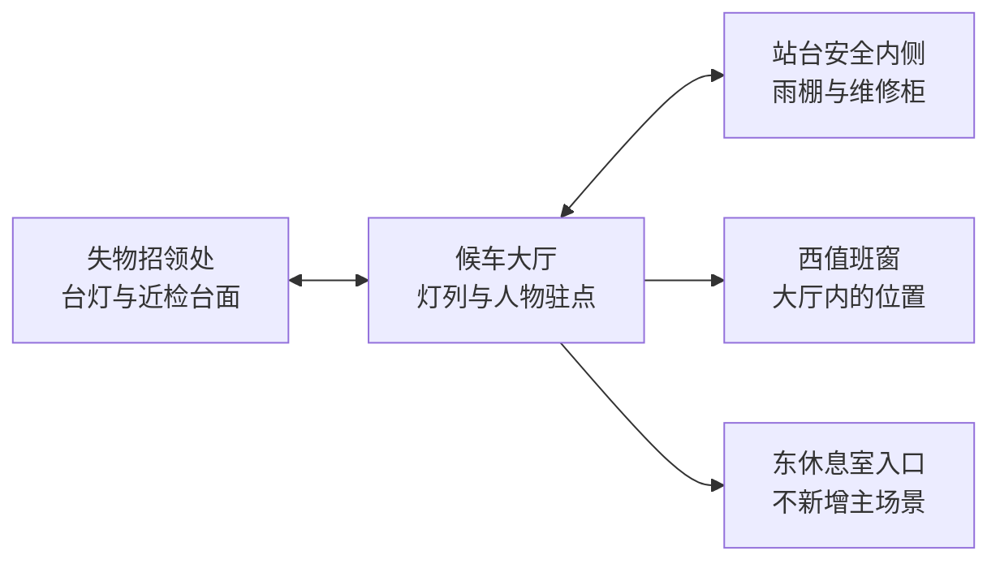
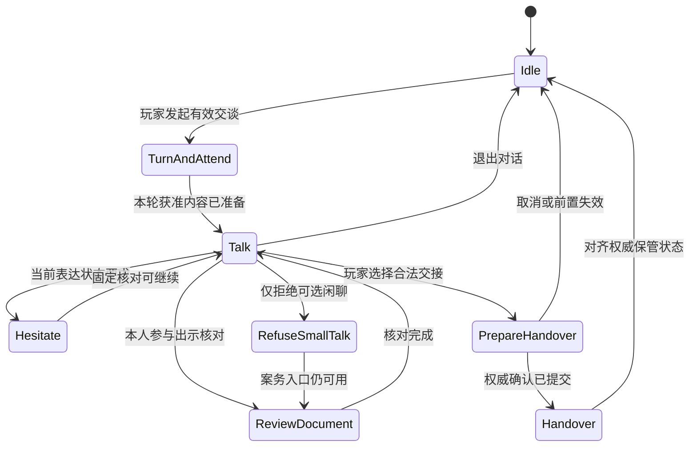
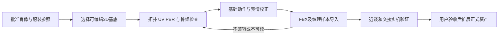

# 阶段 3：HDRP 视觉与资源技术规范

日期：2026-11-21。负责人：Art Director。状态：技术设计提交稿，等待阶段验收；未制作或导入模型、贴图、Scene、Prefab、动画和音频，未改动渲染配置。

本规范服务第一章《停走的怀表》的 Windows PC 第一人称垂直切片。优先保证画面、人物可信度和调查可读性，再按目标硬件测量成本。故事依 [GDD](GDD.md)、[StoryBible](StoryBible.md)及[历史第一章](Sources/HistoricalStory/chapters/chapter_01.md)；事件条件依 [第一章技术映射](Chapter01ImplementationMap.md)，客户端组织依 [TechnicalDesign](TechnicalDesign.md)，状态与接口仅采用 [DataSchema](DataSchema.md)。本文件不另立协议字段或剧情条件。

## 1. 事实、技术基线与本轮范围

已读取阶段 3 任务书、AGENTS、README、GDD、StoryBible、两份阶段报告、Sources/README、历史总纲、时间线、知识矩阵、证据矩阵及第一章。当前工程记录为 Unity 6000.3.29f1、HDRP 17.3.0、Input System 1.20.1、Cinemachine 3.1.7；manifest 与 packages-lock 对应项一致。锁文件已有 VFX Graph 17.3.0，不能将此等同于雨效已制作。

`Assets/_Project/Art/` 已有 Characters、Environment、Props、Materials、Textures，另有 Audio、VFX。当前项目专用目录主要为占位；`Assets/Settings/` 中存在 HDRP High Fidelity、Balanced、Performant 等模板资产。这里只提出未来映射，不复制、升级或修改它们。Server 仍为骨架，无据此宣称存在的天气、配音或 AI 动画服务。Git 文件整体未跟踪，资产导入前需按 [开发路线](VerticalSlicePlan.md)建立获准基线。

已确认的叙事锚点：青禾镇旧站、关闭前的雨夜；失物招领处 ↔ 候车大厅 ↔ 站台安全内侧；老周今夜 59 岁、林遥 25 岁；怀表 QH-283、背刻 0412·0916、九点十七分的指针与侧冠损伤。精确公历年份、人物肖像、服装年代、材质实物参照和配音选角仍未确定。不得把美术建议反写成故事事实。

本轮只写本文件。未来 Scene、Prefab、Animator Controller、输入与界面集成由 Unity Engineer 唯一写入；美术提供获准的 Art/Audio/VFX 文件及材质，交接具体路径后由 Unity 集成。现有 `Art/Materials/` 优先沿用，不另建根 Materials、不迁移 .meta、不手写 Scene YAML。

## 2. 视觉设计语言与验收原则

总体为写实、克制、具有生活使用痕迹的中国小城火车站。深蓝夜景承担空气与远近关系，暖黄灯光承担工作、等待和人物交流。材质呈现木、搪瓷/涂漆金属、纸、旧玻璃、水和布的区别；不以统一“脏滤镜”或过强锐化替代细节。画面有电影化构图，但玩家保持第一人称观察权，信息不能依赖不可跳过的镜头。

| 原则 | 应有表现 | 退回条件 |
| --- | --- | --- |
| 光源可信 | 台灯、顶灯、檐灯有可辨来源；照亮的方向与投影一致 | 漂浮光球、无来源强轮廓光、灯具发光却不照邻近表面 |
| 调查可读 | 所有关键字段在近检可读，并有逐字文本视图 | 反光盖住编号、雨雾盖住柜位、极浅景深藏住证据 |
| 人物可信 | 注视、呼吸、转身和手部接触连贯，身体不僵停 | 目光翻转、脖子持续极限旋转、脚滑、交接穿手 |
| 空间连续 | 三个区域的门洞、字牌、雨棚和声场可帮助回访 | 为省资源将同一窗口随章节换方向，或凭空新增第四主区域 |
| 线索公平 | 当前台沿缺口只是环境细节；证据取自获批实物和记录 | 用鲜红描边暗示罪责、未经批准的日期/照片/报纸成为新真相 |
| 状态一致 | 只显示玩家实际取得的字段与本人获准的反应 | 看过一个部位就展示完整 E01，向老周出示后林遥同步释怀 |

原稿 2D 背景、立绘和三表情切图预算不沿用。AI 图片仅可作获准视觉研究或纹理候选，不是最终可交互 3D 人物，也不能直接承担关键文字。

## 3. 三个区域与第一人称构图

客户端拟采用 Bootstrap、MainMenu、Station/Chapter01Station 三类 Scene；Station 内以 LostProperty、WaitingHall、PlatformSafe 三个区域根组织，具体由 TechnicalDesign 冻结。以下是空间功能设计，不是已存在的 Scene。

### 3.1 失物招领处

旧木柜台是近景基底，包、联册和台灯构成清楚的工作三角；背后档案柜建立积压件的密度，但不把柜门标签全部做成高对比诱饵。开场包上仅使用批准的「暴雨滞留／A-0641」，怀表、带套、封票袋可同时看见；后两件不开检查资格，也不通过模型细节提前露出第二、三章信息。

台灯提供暖色主光，宽面柔补光抬起表盘、纸张与人手；衬垫压低金属杂乱反射。近检背景保持真实工作台质感，同时弱化非目标物。工作灯、纸面反射与镜头曝光必须联合调整，不用拉高物件自发光伪造清晰。包夹层给 E03 查源，柜台副联册给 E04；装袋与暂交后，在桌面留下与权威保管状态一致的物件/回执表现。

### 3.2 候车大厅

以柱列、长椅和连续顶灯形成纵深，入口看得见下一处可通行门洞。老周在清点桌附近，林遥在西窗旁；灯和可步入的谈话空间使两人可辨认，不强迫用悬浮任务标记。老周桌旁保留三箱签动作区；林遥驻点保留读单、签条与回到等待姿态的空间。

西值班窗是林遥关切的历史方位，不加“母女错过”之类剧透标语。东休息室只通过既有区域内入口与记录表达；今夜大厅可见西窗不等于十二年前林遥从东室看得到它。指示牌采用一致的字形、底色和磨损；具体年代未确认前不印年份、真实站徽或未经授权的铁路标识。

### 3.3 站台安全内侧

雨棚柱、内侧暖灯与远端铁轨形成明确消失点。雨幕集中在露天远景，雨棚下保留干湿过渡，积水随表面低洼分布；不能把所有地面统一设成镜面。维修柜正面和背页的检查面有稳定照明，安全隔绳不挡住 E02/E05 操作距离。铁轨只承担远景，不提供可跳下的必经路线。

近景雨滴、檐口滴水、远景雨雾分层；降低一层效果后仍看得出雨夜并找到返回大厅的字牌与门洞。十二年前的 21:17 断电通过记录和核对呈现，不让今夜灯光按玩家发问突然跳闸来证明过去；不制作与定案冲突的复车列车或广播。

### 3.4 空间尺度与光色起点

Unity 物理光照按 1 单位 = 1 米的约定校准，不在不同区域混用缩放。灯具使用真实单位而非无意义的大数，依近检台面、脸部与环境实测调整。[HDRP 17.3 物理光单位](https://docs.unity3d.com/Packages/com.unity.render-pipelines.high-definition@17.3/manual/Physical-Light-Units.html)

建议室内工作灯以 2700–3400 K 为试灯起点，夜景以中性底上轻微冷色分离；这些范围为 [待确认]，需用户确认视觉样张与目标显示设备，不能据此推定故事年代。灯强度、曝光 EV、环境雾密度、门洞/台面尺寸及谈话镜头距离均在获准灰盒和 LookDev 中冻结；当前不填写假测量值。

## 4. HDRP 材质、光照、天气与后期

### 4.1 材质交付

| 资产类 | 材质方法 | 重点检查 |
| --- | --- | --- |
| 木柜/长椅 | Base Color 去除强方向烘焙阴影；正常/磨损区分粗糙度；边角损耗集中于实际接触处 | 不把每条边都磨成白线，不把木纹缩放成不合尺度 |
| 金属柜/怀表 | 区分裸露金属与漆/污层；细划痕随使用方向；高光受控 | 不将锈、油漆、金属全部设同一个 Metallic 值；损伤几何不可仅靠随机纹理 |
| 纸档案/布袋 | 纸纤维、折痕和布织纹低对比；批准文字另行精确排版 | 文字不使用 AI 乱码；老化不盖关键字段；不加入未批准字迹 |
| 雨地/玻璃 | 干湿遮罩、局部水面和细雨滴分开；玻璃保留厚度和污痕逻辑 | 过度透明叠层、反射噪声、室内“下雨”、水面吞没提示 |
| 皮肤/眼睛/头发 | 适配 HDRP 的皮肤次表面表现、独立眼表与毛发方案；先用最少必要材质槽 | 蜡感皮肤、白眼发光、齿龈无暗部、头发透明排序闪烁 |

HDRP Lit 的 Mask Map 按 R=Metallic、G=AO、B=Detail Mask、A=Smoothness 打包，作为线性数据；Base Color 的颜色信息与法线/遮罩数据分开导入，Roughness 来源须明确转换方向，不能把 Roughness 当 Smoothness 直接塞入。具体压缩与最大尺寸依画质档和实测选择。[HDRP 17.3 Mask Map](https://docs.unity3d.com/Packages/com.unity.render-pipelines.high-definition@17.3/manual/Mask-Map-and-Detail-Map.html)

### 4.2 灯光与反射

建议以静态环境光照、反射探针及有限动态关键灯建立稳定基底，角色/手部获得连续的间接光。可变门、角色和物件的阴影按实际需求保留；避免所有远灯实时投影。烘焙方式及已有探针方案先由 Unity Engineer 核对，不为追求某术语更换全局方案。

先完成无雾、无雨、无强后期的可读基准，再逐项加效果。近检使用可预期的曝光；室内外切换可以缓变，但物证与对话期间不能“曝光抽动”导致文字忽明忽暗。反射先有环境探针回退，SSR 仅补当前屏幕细节，不让关键对象只存在于反射里。是否增加平面反射为 [待确认]：建议仅在单处英雄积水验证收益，原因是额外视图与更新成本；需用户确认目标画质档和该镜头是否必要。[曝光](https://docs.unity3d.com/Packages/com.unity.render-pipelines.high-definition@17.3/manual/Override-Exposure.html)、[反射探针](https://docs.unity3d.com/Packages/com.unity.render-pipelines.high-definition@17.3/manual/Reflection-Probes-Intro.html)

### 4.3 天气与后期

雨是空间分层，不是全屏遮罩。户外落雨、雨棚滴水、地面溅水、玻璃雨痕各自有边界与剔除；纸档、NPC 和近检物不能因为天气混入未经剧情允许的新增损坏。体积雾用于灯锥和纵深，最强雾不覆盖读柜正面。雾和粒子的开关应独立便于测量，不与证据状态绑定。[HDRP 17.3 体积光](https://docs.unity3d.com/Packages/com.unity.render-pipelines.high-definition@17.3/manual/Volumetric-Lighting.html)

后期以统一色调、轻度 Bloom 和可关闭的景深为辅。探索默认不依靠运动模糊、重颗粒、色差、暗角遮蔽边缘线索；近检和读档文本不受景深模糊。若有闪电，仅作可关闭环境表现，不能用短促闪光作为发现 E 的必要条件。具体闪电是否制作为 [待确认]，推荐第一切片不加入，以减少频闪和遮挡对调查的干扰；需确认其视觉价值。

## 5. 怀表、文书与证据影像

E01 是五部位主动检查的合成结果；模型、热点与受控文字要能区分下列内容，具体部位标识仅引用 DataSchema，不另命名网络字段。

| 主动检查部位 | 物件表现 | 信息边界 |
| --- | --- | --- |
| 表盘 | 时针分针可读，表面玻璃损耗不挡针，近检可消除高光 | 指针仅能显示九点十七分；“21:17”与雨夜对应由获批记录核定，不凭表盘证明昼夜/坠表时刻 |
| 背刻 | 0412·0916 精确排版并贴合表背；翻背后才开放该字段 | 只凭刻字不能证明领取权；未检查前不显示刻字全文 |
| 编号 | 后盖边 QH-283 独立可辨，不能与背刻混为一块 | 编号供查同号单据，不在最初焦点提示中自动揭露 |
| 侧冠 | 凹陷形状在侧视可见，旋转/复位后仍定位稳定 | 它是观察到的损伤，不由“看起来坏了”自动断言完整机理 |
| 冠轴损伤 | 获批可见范围内的侧弯/偏斜可观察；热点不需要拆修新玩法 | 传动卡滞的记录来自 E05；不增“修好表”“停电停表”的能力或因果 |

E01 获批全文为：「表面 21:17。背刻 0412·0916。后盖边钢印 QH-283。侧冠凹陷，冠轴可见偏斜。」界面先显示已检查的字段，全部所需部位完成后才显示完整证据卡。不使用镜头自动扫一圈代替玩家检查。

E02/E03/E04/E05 的全文逐字采用 [证据矩阵](Sources/HistoricalStory/evidence_matrix.md)，不能为版面缩短证明条件或自动补字。文书实物可保持纸感，但打开近检即有同权逐字转写；R01 需要交修和指定领件两个来源，不能用刻字或老周姿态取代。

证据影像使用三方向获批图或受控检视捕获方案，具体实现依 TechnicalDesign；清晰文字来源于已批准文本。影像和原件保管分开：A02 暂交后，原物按权威状态离开柜台，手册中的已取照片、编号、检查项与 R02 调查资格继续存在。不凭截图中的未读纹理提前开放未检查字段，不要求生成式图像“猜出”钢印。

## 6. 老周、林遥的 3D 人物规格

### 6.1 人物外观与身份

| 人物 | 已定依据 | 表演方向 | 尚待确定的外观 |
| --- | --- | --- | --- |
| 老周 | 59 岁退休站务，熟悉流程，直接，不善表达情绪；驻清点桌 | 整理箱签动作准确；谈手续目光稳定；敏感问题有短停顿、收手或回看单据 | [待确认]：肖像、身高体型、发型、衣着。推荐朴素实用、符合退休日常身份的中性方案；须用户确认参照与年代，不默认现役制服/徽章 |
| 林遥 | 25 岁返乡者，敏感，对承诺执着；驻西窗旁 | 初见保持距离，读单时视线落在该单；尊重边界后自愿转身面对玩家 | [待确认]：肖像、身高体型、发型、服装。推荐当代感克制的日常层次服装；须用户确认年代、参照，不用年龄/服装暗示额外职业 |

两人都制作可近谈的完整 3D 身体、手、眼与口腔，不能只用正面肖像贴片。人物变化表达当前获准的互动状态，不用夸张“说谎眼神”给玩家答案。未 D02 的林遥不能演出已确认领取授权；只和老周核对不改变她的姿态故事含义。更晚的西窗释怀和录音情绪不纳入第一章无条件演出。

### 6.2 骨骼、表情与导入

建议身体采用可复用的 Humanoid 映射，面部保留稳定命名的 Blend Shapes 或经验证面部骨；眼球、眼睑、下颌、唇形与眉部要有可分别调节的通道。脸、衣服与手的关节变形必须在最终镜头近距验证；肩、肘、手腕、膝与坐姿不能塌陷。骨架和表情表先由 Art 与 Unity 共同冻结，不要求依赖尚未安装的绑定插件。

导出以 FBX + 独立纹理为交换基线，不让运行工程依赖某台机器安装 DCC 来读原生文件；导入后校验单位、朝向、Root、Avatar、法线/切线、蒙皮和 Blend Shapes。Unity 支持的导入内容并不等于某一自动化插件已适配 6000.3.29f1/HDRP 17.3.0；任何自动材质工具先做隔离样本验证。[Unity 6000.3 模型导入](https://docs.unity3d.com/6000.3/Documentation/Manual/ImportingModelFiles.html)

建议每名主角准备 LOD0/1/2，近谈与签条保留脸/手细节；根据屏幕占比切换而非随意固定世界距离。低档也不得在对话距离削掉眼睑、指节或签字道具。切换检查头发轮廓、手和表情，不在演员脸部显著跳变。LOD0 骨骼/Blend Shapes 与低 LOD 映射保持可回放；合并材质时仍保留必要的眼表和皮肤区别。[Unity 6000.3 LOD Group](https://docs.unity3d.com/6000.3/Documentation/Manual/class-LODGroup.html)

### 6.3 Animator 与表演状态

沿用 Unity Engineer 的 Animator 参数约定：`speed`、`turn`、`is_talking`、`emotion`、`gesture`，最终以 TechnicalDesign 为准；这些不是 HTTP 字段。`presentation_id` 仅是本地表现控制器的去重序号，不是 Animator 参数，也不是 HTTP 字段或权威事件 ID。身体移动由 NavMeshAgent/控制器负责，走路使用 in-place 动画；不同时启用冲突的 Root Motion。注视以 Gaze 管理权重、角限与回正，视线不要穿过头后方持续锁玩家。

最低动作清单：各人呼吸/待机、走动、起步停步、左右转身、看玩家/看单据、正常短说话、倾听、迟疑/回避、拒绝闲聊、核对证据、签条、接表/收表、返回驻点；老周另需三个箱签核对。通用身体动作可以共享，手势节奏与面部曲线必须保留人物区别。签条/接表的手指、接触点与衣袋动作不能仅靠通用走路库完成。

交接前就位是可逆表现；服务器提交保管、回执与章节结果后，才呈现不可逆交接。Animation Event 不能发证、改保管或加关系分。暂停、换会话和读档时，以权威已完成结果重建外观：提交前打断回原位，提交后打断可直接落到交接完成姿态，不重复结算。即使动画失败，必要的固定案务文字仍可读，错误反馈不能永久锁住人物。

语音与口型 [待确认]：推荐固定案务先用获批真人/授权配音并校正口型，自由生成段先保证文本与自然聆听动作，是否为自由段增加语音另定。理由是避免动态声音超时与唇形错误影响必要证词；需确认配音语言、来源、预算及授权。当前不接 TTS、不模仿真实个人声音、不制作音频。

## 7. AI 辅助人物、绑定与动画工作流比较

核查日期为 2026-11-21，只引用工具厂商/Unity 官方资料。推荐的是制作流程，不代表工具已安装、可用、获许可或本轮允许购买。所有候选最终版本、导出权、素材权和项目预算均需确认，不用“支持 Unity”替代当前项目样本验收。

| 路线 | 可用能力与来源 | 对本切片的适用性 | 代价/缺口与决定 |
| --- | --- | --- | --- |
| 可编辑人物基底 + Character Creator 类工具 + 受控 DCC 修整 | 官方 CC5 手册可导出带服装人物/动作 FBX；官方 Unity 工作流介绍材质及角色导入。参见 [FBX 导出](https://manual.reallusion.com/Character-Creator-5/Content/ENU/5.0/17-Export/Export-FBX.htm)、[Unity 工作流](https://www.reallusion.com/character-creator/unity-auto-setup.html) | 推荐作为两主角候选主线，身体/脸/衣服可编辑，便于相同骨架与重复迭代 | [待确认]：实际许可、附属服装/皮肤素材、插件版本兼容。先只导出一个非正式样本测试眼/手/皮肤；不直接安装 Auto Setup 或高分辨率全套资源 |
| 本地 DCC 人物制作/合法基底 + 自动绑定/动作库辅助 | Mixamo 支持双足人形自动绑定与动画；有中性姿态/干净网格要求。官方同时明确中国国家代码账户的可用性限制。[Adobe FAQ](https://helpx.adobe.com/creative-cloud/faq/mixamo-faq.html) | 可作身体基础动作备选；不得成为中国本地用户必须依赖的唯一通路 | [待确认]：账号可用性与素材凭证；面部、手指接触和签字仍需独立修整。无法访问时以本地绑定与获准动作代替，不绕过服务限制 |
| Meshy 类图片/文本到 3D + 重拓扑/UV/PBR + 绑定 | 官方将 Remesh、UV、纹理、Rigging、Animate 列为后处理流程。[后处理说明](https://docs.meshy.ai/en/webapp/guides/choosing/post-processing) | 更适合非证据背景道具或体块试验；两主角近谈脸/手不以生成结果直接定稿 | [待确认]：输入图权利、方案许可和私密性。官方区分付费私有输出与免费 CC BY 4.0 等条件，制作前保存实际方案记录。[输出权属说明](https://help.meshy.ai/en/articles/10137554-what-is-the-ownership-of-the-generated-models)；不能把自动 Remesh 等同于合格面部拓扑 |
| Rokoko Vision 类视频到动作 + DCC 清理 | 官方 Vision 3.0 以单视频生成动作，在 Studio 整理并导出 FBX/BVH；现版本不提供手指追踪。[官方产品说明](https://www.rokoko.com/products/vision) | 可辅助走动、转身与大肢体节奏；签字/接表/面部不直接交给身体捕捉 | [待确认]：演员素材、云上传、导出方案与授权；需清脚滑、遮挡和重定向。手指及物件接触用受控关键帧，不承诺“一键全动作” |

推荐组合为“可编辑且授权清楚的 3D 人物基底 → 本地修整/重定向 → 固定骨架与面部表 → 通用动作辅助 → 签条/交接专门校正 → Unity HDRP 样本验收”。AI 参考图和自动网格/动作只减少部分制作工作，不承担故事确认、人物一致性、最终文字或质量批准。

## 8. UI 视觉层级与镜头

UI 延续旧站案务材料的克制质感，用少量纸色、炭灰和暖白文字配合真实人物；纸纹不影响读字，细线和印章只用于已发生状态。不得做彩色统计卡铺满屏幕的后台界面，不把关系数值或作者知识分类显示成“测谎仪”。输入焦点、层级和暂停逻辑依 TechnicalDesign，不凭界面美术改操作条件。

| 界面 | 视觉组织 | 必须保持的行为/可读性 |
| --- | --- | --- |
| 1 主菜单 | 非剧透雨窗/柜台景，单列主要动作 | 不把未检查表背或母女结论放成背景大图 |
| 2 暂停菜单 | 低干扰遮罩、明确当前暂停 | 返回恢复原交谈/手册层，不误确认处置 |
| 3 HUD | 极简焦点、当前目标入口、必要等待反馈 | 不显示关系分、全局 F 或未取得物证名称清单 |
| 4 交互提示 | 单一焦点名与 E；柔和近距高亮 | 不透墙，不用罪责色，不给未读字段全文 |
| 5 对话 | 人物脸/上半身和手部保持可见，字幕占下方稳定区域 | 发言人明确，固定案务句与非关键承接不混成新证词 |
| 6 自由输入 | 下方独立输入栏、组合输入可见、发送明确 | 候选窗口不被裁，焦点期间 W/E/Tab 不触发世界操作 |
| 7 预设话题 | 当前可用话题短列，可回看已谈内容 | 没开放的话题不以灰字泄露秘密；模型失败入口仍在 |
| 8 出示证据 | 物证缩略图/编号/来源/所选字段，目标 NPC 清楚 | 只列已登记项，确认前可取消，不默认同时出示给两人 |
| 9 物品近检 | 物件为主，侧栏仅显示已检细节与旋转/缩放/复位 | 五部位可独立操作，文本视图不自动勾完未检项 |
| 10 调查手册 | 纸页/标签层级，物证与证词分类 | 原话、玩家假设、已过命题有不同标题与文字标签 |
| 11 关联/推理 | 少量选中 E 卡、命题和显式提交，关系线可读 | 连线只表示玩家组合，不能画线即通过；缺项不剧透 |
| 12 人物档案 | 当前玩家已知身份及实际谈话摘要 | 不显示 H/N 清单、作者秘密、没给本人的材料 |
| 13 关系反馈 | 姿态、称呼、简短语境反馈 | 不用红绿条宣告“说谎/真诚”；拒聊仍保留案务入口 |
| 14 章节交接 | 怀表保管回执与未完成核对摘要 | 选择与固定结果清楚；第一章切片止于交接，不冒充全游戏结局 |
| 15 设置 | 同一材质/文字语言的分组清单，预览与恢复明确 | 高中低、字幕/字体、景深/模糊可用，不在设置中暴露技术日志或秘密 |

证据卡的顺序是“是什么 → 来自哪里 → 看见了什么 → 可以支持什么”，不能只给物件美图和一个“发现线索”。正文以固定文本排版，图片只提供形状与现场关系。建议 1080p 正文从 24 px 左右试排、字幕支持放大到 150%；数值为 [待确认]，推荐以实际中文屏幕阅读验证确定，需确认最低支持分辨率和字体授权。长姓名/大字/输入法弹窗必须重排，不依赖截断省略关键证词。

对话镜头轻微转向本人但不强行切到贴脸；允许退出，镜头回到原探索朝向。近检相机与世界相机分离只为读物，不引入另一份会决定证据的物理实体。镜头缓动强度/FOV/头部晃动 [待确认]：推荐轻微、可关闭晃动，不用强制景深遮细节；需与用户确认舒适性样本。

## 9. 声音、字幕与人物口型

声音分雨幕、檐滴、室内声场、脚步/纸张/金属物件、固定语音与克制配乐。声场变化支持区域连续性，纸张和怀表交互声增强触感，不用“推理正确音效”代替明确文本反馈。第一章录音带只是后章引入，不提前播放余声，更不生成被覆盖原声。

固定台词严格依第一章来源逐句录制/展示，字幕同步、发言人明确；音量设置和静音不影响案务资格。字幕中的声源说明仅写玩家当时可辨内容，不能在未知时自动标“沈禾母亲”。自由段即使未来支持语音，也不得改变固定案务原文或把生成输出写成证词。

音频格式、采样率、压缩、声道/流式策略为 [待确认]：推荐工作源保留无损，短交互声与语音按加载成本分别处理；需确认语言、平台音频预算和素材授权后在导入样本冻结。当前无实际资源，不报告口型同步或响度达标。

## 10. 质量档、预算建议与测量方法

### 10.1 高/中/低质量档

优先映射现有 High Fidelity / Balanced / Performant 资产，但先核对各档实际配置；文件名不保证其已符合下表。下表是设计目标，任何所需 ProjectSettings/共享 HDRP 修改必须另获授权。

| 项目 | 高档候选 | 中档候选 | 低档候选 | 三档不变项 |
| --- | --- | --- | --- | --- |
| 环境光/阴影 | 更完整近景接触与关键动态阴影 | 保留人物/台面/维修柜关键影，压远影成本 | 进一步降低远影分辨率/距离，保留交互空间轮廓 | 不删除柜门/人物遮挡关系 |
| 反射 | 探针基底 + 局部 SSR；平面反射仅样本批准后 | 探针 + 缩减 SSR 覆盖/质量 | 探针为主，可关 SSR | 怀表/水材质仍可辨，证据不靠反射存在 |
| 体积雾 | 有限灯锥与远近层次 | 缩范围与采样成本 | 可禁局部体积或显著减弱，保留普通远景色层 | 维修柜和返程牌始终可读 |
| 雨水粒子 | 近/中/远分层、有限溅水 | 降密度与溅水覆盖 | 保留远雨/檐滴提示，减少近景透明层 | 不再出现穿棚雨，不影响取证资格 |
| 人物 | 近谈 LOD0、完整脸手和必要皮肤表现 | 近谈仍保脸手，减远处皮肤/头发成本 | 不削弱必要表情和签条接触，优先降远景 | 两主角身份与动作语义一致 |
| 贴图/模型 | 英雄物件高细节，远景 LOD | 按投影尺寸降非关键纹理 | 再降装饰物纹理与远景细节 | E01–E05 文字、损伤和热点保持有效 |
| 后期 | 克制 Bloom，景深可关，运动模糊默认不依赖 | 更轻后期 | 可全关非必要后期 | 调查信息同权，无“高档独占线索” |

### 10.2 制作起点预算（均 [待确认]）

| 对象 | 推荐试制起点 | 理由与用户须确认事项 |
| --- | --- | --- |
| 两 NPC LOD0 | 每人身体/衣服合计约 80k–140k 三角形试制；头发单独记透明过绘，LOD1/2 约降至 50%/20% 作为起点 | 近谈脸手优先；实际预算按目标 GPU、可见人数、蒙皮和材质成本测定，需确认目标配置/镜头 |
| 人物纹理 | 头部优先 4K、身体/服装 2K 试制，眼口按投影尺寸控制；不默认 8K | 先证实近景收益再扩大；需确认显存和画质目标，不能仅按分辨率判断质量 |
| 怀表英雄模型 | 支持可见曲面、钢印和五部位的独立近检模型，远景另简化；不先锁面数 | 受侧冠轮廓与近检放大限制；需确认最小真实尺度和最大放大，不以随机高面数证明高质量 |
| 环境贴图 | 模块/平铺纹理与局部文字贴图分离，证据单据专用可读源 | 避免整面柜/地面铺超大图；需确认目标输出与资产清单 |
| 交付性能目标 | 建议先以 SDR 1920×1080、60 fps 为评估候选，三个质量档分别跑同路径 | 这是建议目标，未定最低/推荐硬件、帧时阈值和加载预算；需用户确认后才形成性能准入标准 |

不在未知硬件上断言任一档已达标。若测量显示必须削减，先处理远景阴影、透明叠层、SSR/雾和不可见动画，不先牺牲证据文字与谈话脸手。

### 10.3 后续测量规程

在 Windows Development Player 的固定存档、固定机位/镜头路径、固定分辨率与画质上采样；Editor 数据仅作定位。记录 CPU/GPU 型号、驱动、内存/显存、构建和内容版本、分辨率、质量档、VSync/帧限及冷/热启动。以无额外效果基线逐个启用阴影、雾、雨、SSR、皮肤/头发、后期，比较 CPU/GPU 帧时、P95/P99 卡顿、显存、批次和透明过绘。

至少采三段：失物台旋表/读单、近谈两主角/签条、站台雨棚回望大厅。每段先预热再固定时长采集，建议 30 秒预热 + 60 秒采集为 [待确认] 起点，由 QA 结合目标硬件确认；另记录首进区域/首次播放动作的加载尖峰。高/中/低保持相同调查操作，截图与文字逐字核对同时进行。

验收证据应包含设置导出、原始 profiler/capture、对照截图和问题单；不能只给平均 fps 或一张美图。具体阈值由 TestPlan 和用户批准的目标硬件确定。本轮没有启动 Unity、Player 或 Profiler，所有成本/效果/性能结论尚未验证。

## 11. 未来资产清单与交接格式

以下为获准开发后的责任范围示意，不在本轮创建目录或资产。每条资源登记用途、来源 URL/作者、许可及取得时版本、输入参照权、DCC/导出版本、比例/朝向、骨架/表情表、材质槽/贴图、LOD、碰撞、依赖、负责人和验收截图；没有凭证不进入正式素材集。

| 交付组 | 建议未来目录（相对 Assets/_Project） | 具体可验收内容 | 唯一集成责任 |
| --- | --- | --- | --- |
| 主角资产 | Art/Characters/ 下老周、林遥各自资源组 | FBX、纹理、表情表、LOD、基础/签交接动作、导出说明 | Art 交资源；Unity 写 Prefabs/NPCs、Animator Controller 与 Scene |
| 关键物件 | Art/Props/ 下怀表、A-0641 包、单据册、软衬袋、暂收条、箱签 | 五部位可见、精准字符、近检/远景、对齐点和简化碰撞建议 | Art 交资源；Unity 写 Prefabs/Interactables 和热点 |
| 环境模块 | Art/Environment/、Art/Materials/、Art/Textures/ | 柜台、柜、柱/椅、门窗、雨棚、维修柜、安全隔绳、轨道远景；PBR与LOD | Art 交模块；Unity 独占 Station Scene 布局与碰撞 |
| 雨与后期方案 | VFX/；材质沿用 Art/Materials/ | 分层雨/滴水/溅水方案与档位建议，不内置剧情状态 | Art 交VFX；Unity在授权场景/配置内集成 |
| 声音 | Audio/ | 固定语音、雨/脚步/纸金属声和字幕对照；来源授权 | Art交声音；Unity接播放状态，Narrative核文本 |
| UI 视觉 | Art/Textures/ 或获准同根子目录 | 纸纹、薄线、状态图标、字体授权与九宫格/缩放说明 | Art交视觉；Unity独占Prefabs/UI和界面行为 |

命名采用稳定角色/资源语义、类型和版本，重导入保留路径和 .meta GUID；不得删除 .meta 再“清理重来”。源文件和导出文件按授权与体积制定版本管理方案，LFS 只在明确文件类型、存储成本和协作方案后启用，不能为全部 Assets 批量改规则。

## 12. 视觉验收与未决事项

| 验收 ID | 可执行检查 | 通过条件 |
| --- | --- | --- |
| VIS01 | 同存档在三档走失物处→大厅→站台→回台 | 路径/字牌/柜位可辨，关键物和操作入口同权，不随机移位 |
| VIS02 | 依次只检查怀表五部位并对照手册 | 未检字段未显示；编号/背刻/侧冠与固定字句一致；没有一眼全取 |
| VIS03 | 强反光角度与最大允许放大读表/读联 | 文本视图逐字一致，高光/景深/老化不遮关键字段，无凭空补字 |
| VIS04 | E03/E04只给老周，再切看林遥 | 林遥不表演已确认授权；本人D02后才有对应读单反应 |
| VIS05 | A02确认前取消，确认后打断/读档 | 原物/手中物/回执与权威状态一致，照片保留，无双表、穿手或重复交接 |
| VIS06 | 对话转身、离开正前方、近看眼口/手部 | 注视可自然解除，关节不扭断，口型无持续错帧，签条接触稳定 |
| VIS07 | 关闭景深/模糊，静音，开字幕，大字至候选上限 | E01–E05及必要对白仍能读懂，字形/候选框/确认键不遮挡 |
| VIS08 | 1280×720、1920×1080、2560×1440 与可用宽屏做布局检查 | 这是测试矩阵建议，支持范围 [待确认]；所有获准分辨率无关键文本截断，长句能滚动/分页 |
| VIS09 | 低雨雾/SSR关闭并回走站台 | 仍看出天气与远近，维修柜/返回口清楚，证据不靠特效出现 |
| VIS10 | 角色近谈→远走→返回触发LOD，再重复签条观察 | 脸手与头发不显著跳变；状态恢复不丢模型/表情或持物 |
| VIS11 | 对照三段固定机位的逐项效果开关采样 | 有原始记录与目标配置；满足未来批准阈值才可称性能通过 |
| VIS12 | 查所有可读背景字、声音、物品造型与台词字幕 | 没有新增案情、错误年份、真实品牌侵入；原录音/私密信息无提前泄露 |

详细运行步骤、缺陷等级与证据保存方式由 [TestPlan](TestPlan.md)统一；VIS 是视觉检查定位，不另立与剧情冲突的资格。首个可验收美术样本应覆盖“怀表近检 + 一位主角读单/签条 + 一段雨棚返程”，证明关键制作方法，再扩三空间和另一主角；最终切片仍须完整两 NPC、三区域与获准剧情。

| 决定 | 推荐与理由 | 需要用户确认 |
| --- | --- | --- |
| [待确认] 目标硬件、分辨率/帧率和视觉预算 | 先锁一台代表机并拍固定三段；画质优先但以测量决定降级顺序 | 最低/推荐配置、目标输出、各档性能门槛 |
| [待确认] 人物/服装/年代与字体 | 先批准两张角色设定及一套站务文字样张，保持既定年龄/关系 | 具体肖像/服装参照、故事年份、字体许可 |
| [待确认] 3D/绑定/动作工具路线 | 推荐可编辑基底+本地修整；AI只作辅助，先样本验证 | 已有软件/资源许可、候选服务可用性、成本与云素材上传范围 |
| [待确认] 配音/自由语音 | 固定案务语音优先，生成自由段先文字；避免必要流程受动态语音失败影响 | 配音人选/语言、口型方案、素材权及是否另做TTS |
| [待确认] 灯光烘焙/动态占比与质量档 | 保留现有管线；用可读基准比较烘焙/探针/动态关键灯 | 目标样张、对既有HDRP设置的具体后续修改授权 |
| [待确认] 空间/镜头及近检范围 | 以灰盒的人手尺度和无遮挡测试冻结，近检背景和高光服从阅读 | 平面尺寸、交互/谈话距离、FOV/晃动、放大上限 |

交付结论仅限设计与官方资料核验。正式模型/资源、画面、动画、中文UI、音频、Windows 性能与玩家体验均尚未运行验证。完成文档后交 Director 和独立 QA 审查，用户批准前不开始制作或推进下一阶段。
