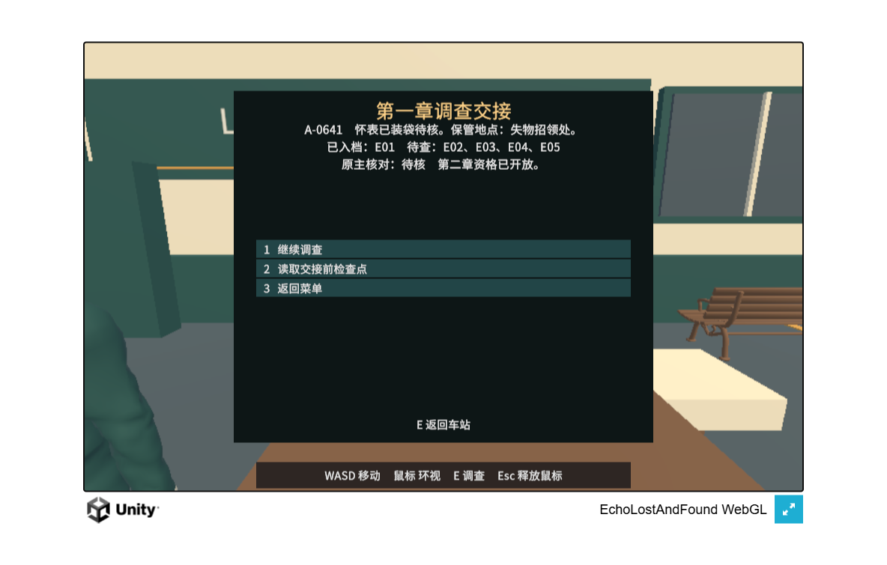

# M4-C 第一章调查交接 · 2026-11-24

**当前可交用户验收。** 本轮可玩交付位于 EchoLostAndFound_WebGL 的 Station 场景。Chrome 实际完成两条保管路线、回退、刷新并重开回执。HDRP 主工程完成独立质量检查，A02 的运行验收针对 URP。阶段推进等待用户明确批准。

**如何复验。** 在 Station 从老周处走到怀表，查齐五处并登记 E01，选“装袋待核”并确认即可最短完章。在交接页读取交接前检查点，查看失物包和副联册取得 E03/E04，从怀表记录核对原主。向林遥本人出示 E03/E04 后选“办理今夜暂收”，读条确认即可改走暂交路线。刷新后在失物包查看保管回执。两条路线都允许继续补证。[浏览器操作证据](M4C/Closeout/browser-01/browser.json) · [最终包与 HTTP 运行方法](M4C_WebGL_Verification.md)

**交付边界。** 按用户确认，结算以 EvidenceRegistry 与本地 PlayerPrefs 存档为依据。章末资格和回执根据已提交的保管选择确定，服务端原子事务仍待实现。章末只开放 CH02 资格。旧档保留已观察字段与证据，无法从旧档推断玩家此前向哪位 NPC 出示过单据。保管演出采用静态模型显隐；A01、R02、后章玩法、真实模型和公网验收保留在后续范围。

**验收依据。** URP EditMode 22/22、PlayMode 8/8，WebGL 构建 0 错误。HDRP EditMode 2/2，原样批处理 PlayMode 2/5，输入路由与 60 Hz 诊断环境下为 5/5。两个工程均使用 Unity 6000.3.29f1。[测试与日志](M4C_TestResults_Updated.md) · [更新矩阵](M4C_CompletionMatrix_Updated.md)

**工作区。** master 起始有 24 项已跟踪修改和 754 个未跟踪文件。本轮未暂存或提交。原有场景和项目资料保留。Builds 产物、部分日志受 Git 忽略，移交机器时应连同本地证据一起复制。[具体改动](M4C_FileChanges_Updated.md) · [剩余工作](M4C_Remaining_Tasks_Report.md)

