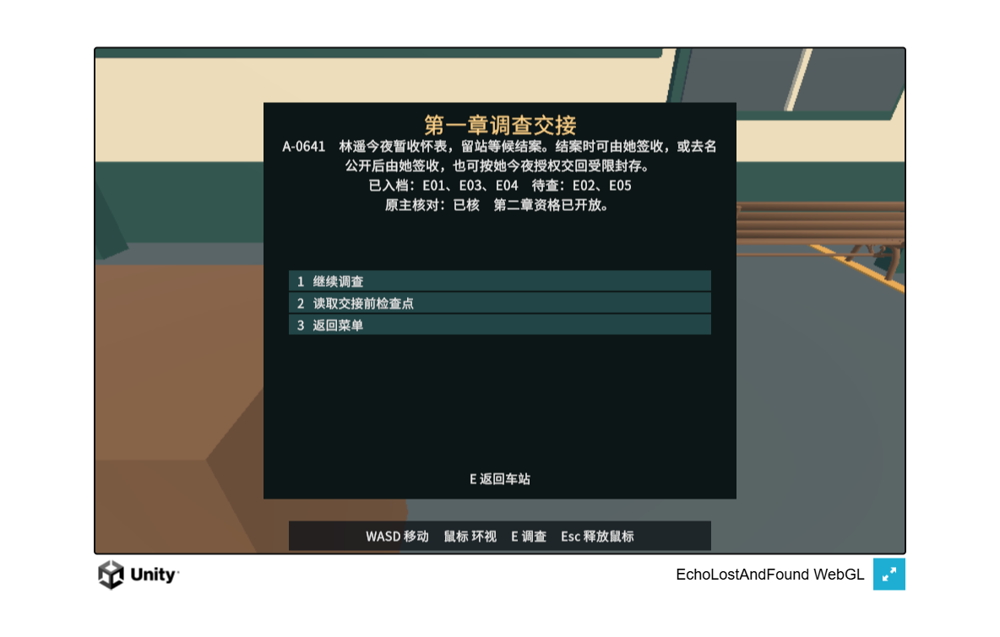

# WebGL 构建与浏览器验收 · 2026-11-24

最终 URP 源码副本使用 Unity 6000.3.29f1、URP 17.3.0 构建 Station。Unity BuildSummary 报告 65,900,529 bytes、7 分 10.923 秒、0 个构建错误。gzip 输出目录实测 17 个文件、21,412,143 bytes。[构建日志](M4C/Closeout/final-Build.log) · [本轮产物](Builds/M4C-Closeout-Player/index.html)

Chrome 157.0.8103.79 在本机回环 HTTP 运行。WebGL 2 使用 ANGLE / SwiftShader。首次加载条消失用时 1.585 秒，最后一次刷新 0.958 秒。FastAPI 为同源 Mock，浏览器实际请求了 WASM、框架和 data，均返回 200。[浏览器事件与网络记录](M4C/Closeout/browser-01/browser.json)

1. 从老周处走向怀表，逐一查看五个部位，E01 入档，确认装袋。页面列出保管地点与其余待查证据。[装袋回执截图](M4C/Closeout/browser-01/04-bag-settlement.png)
2. 读确认前检查点，经失物包与副联册获取 E03、E04，返回怀表记录并显式提交原主推理。[R01 截图](M4C/Closeout/browser-01/05-owner-conclusion.png)
3. 向林遥出示两张单，读暂收条，确认暂交。章末显示 E01、E03、E04 已入档，E02、E05 待查，第二章资格已开放。[可读暂收条](M4C/Closeout/browser-01/06-temporary-receipt.png) · [暂交结算](M4C/Closeout/browser-01/07-handover-settlement.png)
4. 刷新页面，走回失物包，从保管回执重开章末页。两次结算、大检查点回退和刷新均由浏览器按键与场景交互驱动。脚本记录 completed=true，异常、对话框与软失败均为零。

在项目根目录复现时，将 WEB_ROOT 指向 Builds/M4C-Closeout-Player，以 MODEL_PROVIDER=mock 运行 Server 的 uvicorn app.main:app 并绑定 127.0.0.1:18841。执行 `node M4C/Scripts/m4c-e2e.mjs http://127.0.0.1:18841 <新的证据目录> chapter`。需通过 HTTP 载入构建。公网部署与最终包在物理 GPU 上的帧率均为 UNVERIFIED。
